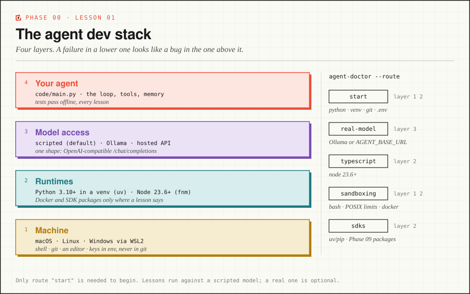

# Your Agent Dev Environment

> Agents fail in ways that look like model problems but are really setup problems. Check your machine once, properly, and you'll stop debugging the wrong thing.

**Type:** Build
**Languages:** Python 3.10+ (stdlib only)
**Prerequisites:** None
**Time:** ~45 minutes

## Learning Objectives

- Set up the four layers an agent runs on: the machine, the runtimes, model access, and your agent code. Know which layer each failure comes from.
- Install Python with a virtual environment (uv) and, for the TypeScript lesson, Node, on macOS, Linux or Windows (WSL2).
- Connect a model, local with Ollama or hosted, through the one interface every lesson uses: `AGENT_BASE_URL` + `AGENT_MODEL` over the OpenAI-compatible API.
- Keep API keys out of code, logs and git, and run `agent-doctor` to check whichever route through the course you're starting.

## The Problem

Your first agent will fail. When it does, you need to know whether the fault is in your loop, the model, or your machine:

- "Connection refused" might mean Ollama isn't running.
- A tool call that does nothing might mean you picked an embedding model, which can't chat.
- A 401 means your key isn't exported in *this* shell.
- A `SyntaxError` on `int | str` means you're on Python 3.9.
- A `.env` you created "just for testing" can sit one `git add .` away from publishing your key.

None of these are agent problems, but each one can eat an hour, because the symptom shows up a layer above the cause. A missing model looks like a broken loop. A wrong Python version looks like a typo in the lesson.

This course also has more than one way through it. You don't need Docker to start, or LangGraph until Phase 9. So the check you run should depend on the route you're taking: everything the route needs gets checked, and nothing it doesn't need gets in the way.

## The Concept



### Four layers

| Layer | What's in it | Typical failure | What it looks like from above |
|-------|--------------|-----------------|-------------------------------|
| 1 · Machine | OS (macOS, Linux, WSL2), shell, git, editor | No `bash` on Windows, git missing | "The shell tool returns nothing" |
| 2 · Runtimes | Python 3.10+ in a venv, Node 23.6+, Docker, SDK packages | Python 3.9, packages in the wrong interpreter | `SyntaxError`, `ModuleNotFoundError` |
| 3 · Model access | Scripted model, Ollama, or a hosted API | Server down, wrong model name, key not exported | "The agent loops", "the agent says nothing" |
| 4 · Your agent | The lesson's `code/main.py` | A real bug, finally | |

Fix layers bottom-up. Debugging layer 4 while layer 3 is broken is the hour you're trying to save.

### You don't need a model to start

Every lesson runs **offline by default** against a *scripted model*: a function that replays fixed assistant messages. Tests and demos are deterministic, free, and work on a plane. A real model is something you switch on per run:

```bash
AGENT_BASE_URL=http://localhost:11434/v1 AGENT_MODEL=llama3.2 python3 code/main.py
```

Those two variables (plus `AGENT_API_KEY` for hosted APIs) are the whole interface. Every lesson talks to models through the **OpenAI-compatible** `/chat/completions` format, which Ollama, OpenAI, vLLM, LM Studio, OpenRouter and many others accept. Switching providers means changing a URL, not rewriting code.

### Local vs hosted

| | Local (Ollama) | Hosted (OpenAI, Anthropic, …) |
|--|----------------|-------------------------------|
| Cost | Free after download | Pay per token |
| Privacy | Nothing leaves your machine | Prompts go to the provider |
| Capability | Good for learning; small models make more tool-calling mistakes | Strongest models, most reliable tool use |
| Setup | `ollama pull llama3.2` | Create a key, export it |

Small local models are *useful* while learning because they fail visibly. You'll see malformed tool calls you'd rarely get from a frontier model, and your loop has to handle them.

### Routes

| Route | For | Checks |
|-------|-----|--------|
| `start` | Phases 00–08, the core course | Python 3.10+, venv, git, no `.env` git would commit |
| `real-model` | Any lesson against a real model | A reachable model through `AGENT_BASE_URL`, or a running Ollama with a chat model |
| `typescript` | Lesson 00.02's TypeScript versions | Node 23.6+, which runs `.ts` files directly |
| `sandboxing` | Phases 10 and 12: shell tools and sandboxes | bash, the POSIX `resource` module, Docker (optional) |
| `sdks` | Phase 09 and 11.06: the optional `with_<framework>.py` demos | uv or pip, an active venv, which framework packages are installed |
| `all` | Everything | All of the above |

A check fails only if the route can't work without it. Things a route can live without (Docker, framework packages, an API key when you have Ollama) are warnings.

### Keys are secrets

- Keys live in environment variables, or in a `.env` file that `.gitignore` excludes. Never in code, a notebook cell, or a log line.
- Print *which* keys are set, never their values. `agent-doctor` has a test that proves it.
- If a key ever reaches a commit, rotate it. Deleting the commit isn't enough: clones, forks and caches keep it.

## Build It

### Step 1: The machine

**macOS:**

```bash
xcode-select --install                     # compilers, git
/bin/bash -c "$(curl -fsSL https://raw.githubusercontent.com/Homebrew/install/HEAD/install.sh)"   # Homebrew
```

**Ubuntu / Debian:**

```bash
sudo apt update && sudo apt install -y build-essential git curl unzip
```

**Windows:** use WSL2. Several lessons give the agent a bash tool and use POSIX resource limits, which native Windows doesn't have.

```powershell
wsl --install -d Ubuntu-24.04
```

Then follow the Ubuntu steps inside WSL, and keep the course inside the Linux filesystem (`~/`), not `/mnt/c`. File access across that boundary is slow.

### Step 2: Python with uv

[uv](https://docs.astral.sh/uv/) installs Python itself, creates virtual environments, and installs packages, much faster than pip:

```bash
curl -LsSf https://astral.sh/uv/install.sh | sh
git clone https://github.com/Ramakm/agentic-ai-from-scratch.git
cd agentic-ai-from-scratch
uv venv --python 3.12                      # creates .venv with Python 3.12
source .venv/bin/activate
python --version
```

No uv? `python3 -m venv .venv && source .venv/bin/activate` works too. Most lessons need only the standard library, so the venv mostly matters later, when Phase 9 installs framework packages and you don't want them in your system Python.

### Step 3: Node (only for the TypeScript lesson)

Lesson 00.02 has a TypeScript version of its code. Node 23.6+ runs `.ts` files directly by stripping the types, with no build step. Use a version manager so you can switch versions per project:

```bash
brew install fnm                           # Linux: curl -fsSL https://fnm.vercel.app/install | bash
fnm install 24 && fnm use 24
node --version
```

On Apple Silicon, check that `node -p process.arch` prints `arm64`. If it prints `x64`, your shell is running under Rosetta and everything will be slower. Open a native terminal and reinstall.

### Step 4: A model (optional, but you'll want one by Phase 1)

Local:

```bash
brew install ollama                        # Linux: curl -fsSL https://ollama.com/install.sh | sh
ollama serve                               # or open the Ollama app
ollama pull llama3.2                       # a 3B chat model with tool calling, ~2 GB
```

Or hosted, through any OpenAI-compatible endpoint:

```bash
export AGENT_BASE_URL=https://api.openai.com/v1
export AGENT_MODEL=gpt-4o-mini
export AGENT_API_KEY=...                   # in this shell, or a git-ignored .env
```

### Step 5: Run agent-doctor

From the repo root:

```bash
python3 phases/00-setup-and-tooling/01-your-agent-dev-environment/code/main.py
```

Real output from a Mac with no venv active:

```text
agent-doctor · route: start · Phases 00-08: the core course, offline with a scripted model

[ok]   Python        3.13.7
[warn] Virtual env   not active
                     fix: uv venv && source .venv/bin/activate   (or: python3 -m venv .venv)
[ok]   git           git version 2.46.0
[ok]   Secrets       no .env files that git would commit

Ready for route 'start'.
Next: python3 phases/00-setup-and-tooling/02-python-typescript-for-agents/code/main.py
```

The exit code is `0` when the route is ready and `1` when it isn't, so you can use it in scripts and CI. `--list` prints the routes, `--json` prints the result for other programs (or an agent) to read, and `--show-later` previews what later routes will need without letting them block this one.

### Step 6: Check a real model

```bash
python3 phases/00-setup-and-tooling/01-your-agent-dev-environment/code/main.py --route real-model --ping
```

With Ollama running and three models pulled (`llama3.2`, `moondream`, `nomic-embed-text`):

```text
agent-doctor · route: real-model · Run any lesson against a real model with AGENT_BASE_URL + AGENT_MODEL

[ok]   Python        3.13.7
[ok]   Secrets       no .env files that git would commit
[ok]   Model         Ollama, 2 chat model(s), using llama3.2:latest
                     use: export AGENT_BASE_URL=http://localhost:11434/v1 AGENT_MODEL=llama3.2:latest
[warn] API keys      none set (fine with a local model)
                     fix: export OPENAI_API_KEY=...   (in this shell or a git-ignored .env, never in code)

ping llama3.2:latest -> 'agent ready' in 0.4s

Ready for route 'real-model'.
Next: AGENT_BASE_URL=http://localhost:11434/v1 AGENT_MODEL=llama3.2:latest python3 phases/03-the-agent-loop/01-the-agent-loop-in-120-lines/code/main.py
```

"2 chat model(s)" because `nomic-embed-text` was dropped: it's an embedding model and can't hold a conversation. The first ping after starting Ollama took 5.1s while the model loaded into memory; this one took 0.4s.

The ping goes to `/v1/chat/completions`, the same request every lesson's real-model mode makes, so if it works here it works there. Running the suggested `Next:` command on llama3.2 showed why small models are good teachers:

```text
  act      -> calculator({"expression":"Mount Everest height in feet"})
  observe  <- error: SyntaxError: invalid syntax (<unknown>, line 1)
  think    The tool did not provide a correct output. However, I can provide the answer directly.
```

The model passed a sentence to a calculator. The loop caught the error, passed it back as an observation, and the model recovered. That's Phase 3's subject.

Failures name the problem and the fix. A model name the server doesn't have:

```text
[FAIL] Model         http://localhost:11434/v1 is up but doesn't serve 'gpt-5'
                     fix: export AGENT_MODEL=<one of: llama3.2:latest, moondream:latest>
```

A URL with nothing listening:

```text
[FAIL] Model         http://localhost:9999/v1/models -> URLError
                     fix: is the server running, and does the URL end in /v1?
```

And a `.env` that's been `git add`-ed in a project:

```text
[FAIL] Secrets       tracked by git, so it gets committed: .env
                     fix: git rm --cached .env && echo '.env' >> .gitignore, then rotate every key in it
```

### Step 7: Read how it works

Open `code/main.py`. The pieces:

- **`ROUTES`** maps each route to a description, the check ids it needs, and the `Next:` command. Adding a route means adding one entry.
- **Each check is a small function returning `Check(name, status, detail, fix)`.** Status is `ok`, `warn` or `fail`. Only `fail` blocks the route.
- **Inputs are parameters with real defaults:** `which=shutil.which`, `fetch=fetch_json`, `git_ls=git_lines`, `system=os_name()`. Tests pass fakes instead of patching libraries, and none of them touch the network.
- **`FIXES`** holds the install command per tool per OS, so a Linux user never gets told to `brew install`.
- **`check_model`** tries `AGENT_BASE_URL` first, calling `GET /models`, the OpenAI-compatible model list. It turns a 401 into "check AGENT_API_KEY" and an unknown model into the list of models the server does have. Without `AGENT_BASE_URL` it falls back to Ollama's `/api/tags`.
- **`chat_models`** drops embedding models and ranks known text-chat families first. Before it existed, the ping chose `nomic-embed-text` (which can't chat), then `moondream` (a vision model, which replied with an empty string). Both are real bugs from building this lesson.
- **`check_secrets`** asks git which `.env` files it tracks, and which it would pick up on the next `git add`. It never opens them.
- **`check_keys`** reports variable *names* only.

Run the tests:

```bash
cd phases/00-setup-and-tooling/01-your-agent-dev-environment/code
python3 -m unittest -v
```

## Use It

Which tools you'll need, and when:

| Tool | Used in | Install when |
|------|---------|--------------|
| Python 3.10+ (stdlib) | Every lesson | Now |
| uv / venv | Every lesson; required from Phase 9 | Now |
| git | Cloning the course, versioning your agents; the `.env` check | Now |
| Ollama or a hosted key | Every lesson's real-model mode | By Phase 1 |
| Node 23.6+ | 00.02's TypeScript version | When you reach it |
| bash, POSIX `resource` | 10.03, 10.09, 10.11, 12.05: shell tools and resource limits | Already there on macOS and Linux; WSL2 on Windows |
| Docker | 12.05's optional `--run` | Only if you want to run real containers |
| Framework packages | Phase 9 (`langgraph`, `openai-agents`, `crewai`, …) and 11.06 (`opentelemetry-sdk`) | Per lesson, from its `code/requirements.txt` |
| Claude Code | 09.04's `with_claude_agent_sdk.py` | Only for that demo |

In real projects you'll pair this setup with:

- **direnv** or **python-dotenv**, which load `.env` per project, so keys never live in your shell profile.
- **pre-commit** with a secret scanner such as **gitleaks**, which blocks a commit that contains a key, even one that's not in a `.env` file.
- **LiteLLM** or **OpenRouter**, one OpenAI-compatible endpoint in front of many providers, which fits `AGENT_BASE_URL` unchanged.
- **Dev containers**, the whole stack in a container definition, so a new contributor runs one command instead of this lesson.

## Ship It

`outputs/skill-agent-doctor.md` is a skill your coding agent can load to diagnose a broken agent setup. It runs `agent-doctor --json` for the right route, reads the result, and walks you through fixes one at a time, bottom layer first.

## Exercises

1. **Easy.** Add a disk-space check to the `real-model` route: models are large. Warn below 10 GB using `shutil.disk_usage`. *Hint:* a new check function, one entry in `makers`, and one id in `ROUTES["real-model"]`.
2. **Medium.** Add a `tool-calling` route that sends one request with a trivial tool (`get_time`) and reports whether the reply contains `tool_calls`. Run it against two models and record which one supports tools. *Hint:* reuse `ping`'s `post` parameter so the test can fake the reply.
3. **Medium.** Make `check_secrets` also scan *tracked* files for strings that look like keys (`sk-`, `ghp_`, `AKIA`), reporting file and line, never the match itself. *Hint:* `git grep -n -E` does the search; decide what to do about false positives in test fixtures.
4. **Hard.** Run `agent-doctor --route start` in CI on Linux, macOS and Windows (GitHub Actions has all three). Make the Windows job pass by giving it the right warnings instead of failures, and check that every `fix:` it prints is a command that would actually work on that OS.

## Key Terms

| Term | What people say | What it actually means |
|------|-----------------|------------------------|
| Virtual environment | "venv" | A per-project Python install with its own packages |
| uv | "Faster pip" | One tool that installs Python, creates venvs, and installs packages |
| Scripted model | "Mock LLM" | A function that replays fixed assistant messages, so lessons run offline and deterministically |
| Ollama | "Local LLM" | A server that downloads and runs open models, with an OpenAI-compatible API |
| OpenAI-compatible | "Works like OpenAI" | Accepts the `/chat/completions` request format, so one client works with many providers |
| Embedding model | "The other model" | Turns text into vectors for search; it can't hold a conversation |
| WSL2 | "Linux on Windows" | A real Linux kernel on Windows, which gives lessons bash and POSIX limits |
| Secret | "API key" | A credential that lives in the environment, never in code, logs or git |

## Further Reading

- [uv documentation](https://docs.astral.sh/uv/)
- [Python docs, `venv`](https://docs.python.org/3/library/venv.html)
- [Ollama, OpenAI compatibility](https://github.com/ollama/ollama/blob/main/docs/openai.md)
- [Node.js, running TypeScript natively](https://nodejs.org/en/learn/typescript/run-natively)
- [Microsoft, Install WSL](https://learn.microsoft.com/en-us/windows/wsl/install)
- [GitHub, Removing sensitive data from a repository](https://docs.github.com/en/authentication/keeping-your-account-and-data-secure/removing-sensitive-data-from-a-repository)
