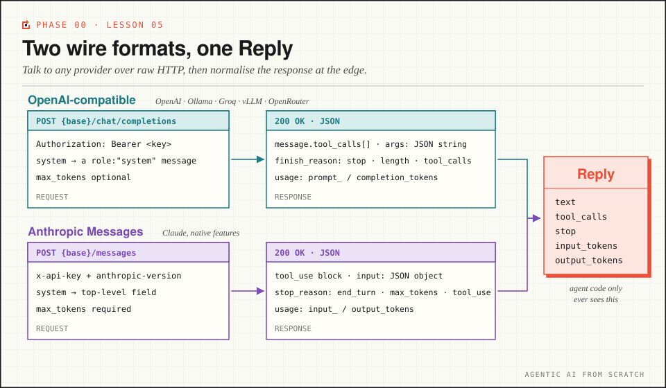

# Calling an LLM over Raw HTTP

> Every SDK is a thin wrapper around one HTTP POST. Write that POST yourself once, in both formats that matter, and no SDK error will ever be a mystery again.

**Type:** Build
**Languages:** Python 3.10+ (stdlib only)
**Prerequisites:** Phase 0 · API keys, providers & rate limits
**Time:** ~45 minutes

## Learning Objectives

- Send a chat request with tools to an LLM using only `urllib`, in the OpenAI-compatible and the Anthropic Messages formats.
- Convert a conversation, including tool calls and tool results, between the two formats.
- Normalize both responses into one `Reply`: text, tool calls, stop reason, and token usage.
- Map HTTP failures (401, 429, connection refused) into one error type that carries `Retry-After`.

## The Problem

You've used `client.chat.completions.create(...)`. Then something breaks:

- `400: messages: roles must alternate between "user" and "assistant"`. Which messages? You never wrote any roles like that.
- The Anthropic SDK wants `max_tokens`, `system` as its own argument, and tool results inside a *user* message. Your OpenAI-shaped history doesn't fit.
- A trace shows a `tool_use` block, and you don't know what the model actually received.

All of these make sense the moment you've seen the wire. Every model call in this course, and in every framework, ends as one JSON body over HTTP. This lesson writes that body by hand, for the two formats that cover almost every provider.

## The Concept



### Two wire formats

| | OpenAI-compatible | Anthropic Messages |
|--|-------------------|--------------------|
| Endpoint | `POST {base}/chat/completions` | `POST {base}/messages` |
| Auth | `Authorization: Bearer <key>` | `x-api-key: <key>` + `anthropic-version: 2023-06-01` |
| System prompt | A message with `role: "system"` | Top-level `system` field |
| `max_tokens` | Optional | **Required** |
| Tool definition | `{"type": "function", "function": {name, description, parameters}}` | `{name, description, input_schema}` |
| Model asks for a tool | `message.tool_calls[]`, arguments as a **JSON string** | A `tool_use` content block, `input` as a JSON **object** |
| You return the result | A `role: "tool"` message with `tool_call_id` | A `tool_result` block inside a **user** message |
| Why it stopped | `finish_reason`: `stop` · `length` · `tool_calls` | `stop_reason`: `end_turn` · `max_tokens` · `tool_use` |
| Usage | `prompt_tokens`, `completion_tokens` | `input_tokens`, `output_tokens` |

The OpenAI format is spoken by OpenAI, Ollama, Groq, vLLM, LM Studio, OpenRouter, and (through compatibility endpoints) Gemini and Anthropic. The Anthropic format is the native one for Claude and gives access to Claude-only features.

### Normalize at the edge

Agent code shouldn't care which wire it talked to. Convert the response into one internal shape (`Reply`) right where it arrives. That's the "validate at the boundary" rule from Lesson 02, applied to providers.

## Build It

```bash
cd code
python3 main.py            # local fake server that speaks both formats
python3 main.py --live     # Ollama (or any AGENT_BASE_URL)
```

### Step 1: The transport

`post_json` is ~20 lines of `urllib`. The interesting part is failure: both APIs put the reason in `{"error": {"message": ...}}`, so it reads that, plus the `Retry-After` header, into one `APIError(status, message, retry_after)`. A refused connection becomes `status=0` instead of a raw `URLError`.

### Step 2: The OpenAI-compatible request

The history goes over as-is. Tools get wrapped in `{"type": "function", "function": ...}`. The parser has one trap: `arguments` is a **string** containing JSON, so it needs `json.loads`, and it can be malformed (Phase 2 deals with that).

### Step 3: The Anthropic request

`to_anthropic_messages` does the real work:

- `system` messages are pulled out into the top-level `system` field.
- An assistant message with `tool_calls` becomes `tool_use` blocks.
- `tool` results become `tool_result` blocks inside a **user** message, and consecutive results are merged into *one* user turn. Two user messages in a row is exactly the "roles must alternate" error from The Problem.

### Step 4: One agent, two wires

`weather_round_trip` asks a question, runs the requested tool, sends back the result, and prints the answer. The same function runs against both formats:

```text
[openai] same agent code, different wire format
  stop=tool_calls tools=[('get_weather', {'city': 'Bengaluru'})]  tokens in/out=61/17
  stop=stop       text="It's 27°C."
  last message sent: {"role": "tool", "tool_call_id": "call_1", "content": "{\"temp_c\": 27}"}

[anthropic] same agent code, different wire format
  stop=tool_calls tools=[('get_weather', {'city': 'Bengaluru'})]  tokens in/out=58/21
  stop=stop       text="It's 27°C."
  last message sent: {"role": "user", "content": [{"type": "tool_result", "tool_use_id": "toolu_1", ...}]}
```

Look at the last line of each: same meaning, different wire.

### Step 5: Errors

```text
status=401 retry_after=None  invalid api key
status=429 retry_after=7.0  rate limit exceeded
status=0   retry_after=None  connection failed: [Errno 61] Connection refused
```

Feed `APIError` straight into Lesson 04's `with_retries`: it knows which statuses to retry and how long to wait.

### Step 6: A real model

With Ollama running, `--live` sends the same round trip to `llama3.2` through its OpenAI-compatible endpoint. From a real run:

```text
stop=tool_calls tools=[('get_weather', {'city': 'Bengaluru'})]  tokens in/out=155/20
stop=stop       text='The current temperature in Bengaluru is 27 degrees Celsius.'
```

A complete tool-using exchange with a local model, in ~20 lines of transport and no SDK.

### Run the tests

```bash
python3 -m unittest -v test_main
```

The fake server is a real `ThreadingHTTPServer` on a random local port, so the tests exercise actual sockets, headers and status codes, not mocks. While building this lesson, one test failed because urllib sends `Anthropic-version` with a capital A: HTTP header names are case-insensitive, and the fake server had stored them in a case-sensitive dict. Compare header names case-insensitively.

## Use It

- **OpenAI SDK**: `client.chat.completions.create(model=..., messages=..., tools=...)` builds exactly the Step 2 body. Point `base_url` at Ollama or Groq and it still works.
- **Anthropic SDK**: `client.messages.create(model=..., system=..., max_tokens=..., tools=...)` builds the Step 3 body, and `content` comes back as blocks.
- **LiteLLM** and the **Vercel AI SDK** do Step 3's conversion for dozens of providers behind one interface.
- When an SDK error confuses you, turn on HTTP logging (`OPENAI_LOG=debug`, or `httpx` logging) and read the body. You now know what it should look like.

## Ship It

`outputs/skill-wire-debugger.md` is a skill that takes a failing LLM request or a confusing provider error, reconstructs the actual HTTP body, checks it against the format rules from this lesson, and fixes it.

## Exercises

1. **Easy.** Add `temperature` and `stop` sequences to both request builders. Where does each provider expect them?
2. **Medium.** Add a third wire format: Ollama's native `/api/chat` (Lesson 03). What's different about how it returns tool calls and usage?
3. **Medium.** Make `to_anthropic_messages` handle an image in a user message (`{"type": "image_url", ...}` in OpenAI format → an Anthropic `image` block with base64 `source`).
4. **Hard.** Plug this `LLM` class into Phase 3 · Lesson 1's agent loop in place of `openai_compatible_llm`, with Lesson 04's `with_retries` around each call. Run it against Ollama, and against Anthropic if you have a key.

## Key Terms

| Term | What people say | What it actually means |
|------|-----------------|------------------------|
| Wire format | "The API shape" | The exact JSON body and headers sent over HTTP |
| Content block | "Parts" | Anthropic's typed pieces of a message: `text`, `tool_use`, `tool_result`, `image` |
| `finish_reason` / `stop_reason` | "Why it stopped" | Normal end, hit the token limit, or wants to call a tool |
| `tool_call_id` / `tool_use_id` | "Call id" | Links each tool result to the request that asked for it |
| Normalization | "Adapter" | Converting each provider's response into one internal shape at the boundary |

## Further Reading

- [OpenAI API reference, Chat Completions](https://platform.openai.com/docs/api-reference/chat/create)
- [Anthropic API reference, Messages](https://docs.anthropic.com/en/api/messages)
- [Anthropic, Tool use: handling tool results](https://docs.anthropic.com/en/docs/build-with-claude/tool-use/overview)
- [Ollama, OpenAI compatibility](https://github.com/ollama/ollama/blob/main/docs/openai.md)
