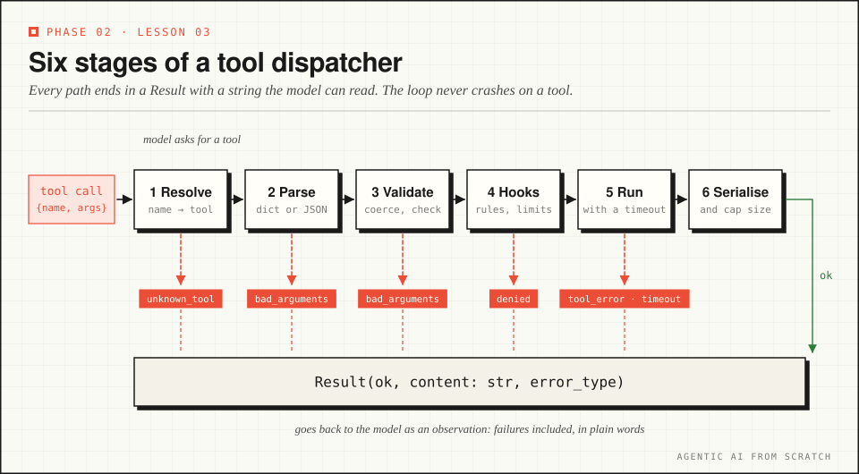

# Writing a Tool Dispatcher

> Between "the model asked for a tool" and "the function ran" there are six steps. Put them all in one place, so every tool gets them for free.

**Type:** Build
**Languages:** Python 3.10+ (stdlib only)
**Prerequisites:** Phase 2 · Lessons 1 and 2
**Time:** ~60 minutes

## Learning Objectives

- Build a tool registry that generates schemas from function signatures and rejects duplicate names.
- Implement a dispatcher with six stages: resolve, parse, validate, hooks, run with a timeout, serialise.
- Return a typed result for every call (ok, or one of five error types), and keep per-tool statistics.
- Measure how many real model calls fail validation, and recover them with lossless argument coercion.

## The Problem

Lesson 1 ran tools with a three-line `run_tool`. That works until:

- the model calls `get_wether`,
- it sends arguments as a JSON string with a trailing comma,
- it sends `"amount": "250"` (a string) to a parameter that wants a number,
- a tool hangs for a minute,
- a tool returns a dataclass, or 50,000 characters,
- someone asks for `send_email` to an outside address,
- and you want to know which tool fails most.

If each tool handles these itself, each tool handles them differently, or not at all. A dispatcher handles them once.

## The Concept

### Six stages



| Stage | Failure it handles | Error type |
|-------|-------------------|------------|
| 1. Resolve | Unknown tool name | `unknown_tool` |
| 2. Parse | Arguments as a dict or a JSON string; broken JSON | `bad_arguments` |
| 3. Validate (after optional coercion) | Missing, unexpected or wrongly typed arguments | `bad_arguments` |
| 4. Hooks | Permission rules, rate limits, logging | `denied` |
| 5. Run with a timeout | Exceptions inside the tool; hangs | `tool_error`, `timeout` |
| 6. Serialise and cap | Dataclasses, dicts, `None`, huge results | — |

Every path returns a `Result` with a string `content` for the model, so the loop never crashes on a tool.

### Coercion: only what can't change the meaning

| Model sent | Schema wants | Coerce? |
|------------|--------------|---------|
| `"250"` | number | Yes: `250.0` |
| `"10"` | integer | Yes: `10` |
| `null` for an optional parameter | integer | Yes: drop it, use the default |
| `"ten"` | integer | No: reject with a message |
| `null` for a required parameter | string | No: reject |

## Build It

```bash
cd code
python3 main.py
```

```text
get_weather      ok               20.3 ms  {"city": "Pune", "temp_c": 24, "sky": "cloudy"}
convert_currency ok                0.1 ms  {"amount": 8410.0, "currency": "INR"}
search_docs      ok                0.0 ms  ["Refunds are issued within 5 days of approval."]
get_wether       unknown_tool      0.0 ms  error: unknown tool 'get_wether'. Available: ['convert_currency', 'get_weather', 'sea
convert_currency bad_arguments     0.0 ms  error: invalid arguments for convert_currency: 'amount' must be number, got str
convert_currency tool_error        0.1 ms  error: KeyError: 'JPY'
slow_report      timeout         210.1 ms  error: slow_report timed out after 0.2s
send_email       denied            0.0 ms  error: send_email may only send to @acme.example addresses, not 'someone@gmail.com'
send_email       ok                0.3 ms  ok
search_docs      bad_arguments     0.1 ms  error: arguments are not valid JSON (Illegal trailing comma before end of object)
```

Ten calls exercise every path (the demo runs with coercion off, so you can see the string-amount rejection).

### Step 1: `Registry.tool()`

A decorator with options (`timeout`, `side_effect`). It builds the schema from type hints and the docstring, and refuses a second tool with the same name, because a silent overwrite would send calls to the wrong function. Lesson 2 builds richer schemas (enums, optionals, descriptions per argument); this registry keeps only what the dispatcher needs.

### Step 2: `Dispatcher.dispatch`

The six stages in order, each returning early with a typed error. Two details:

- **Timeouts** use a thread pool: `future.result(timeout=...)` stops *waiting* after the limit. The thread itself keeps running in the background. Python can't kill a thread, so truly runaway tools need a subprocess. The timeout protects the agent's latency, not the machine.
- **Hooks** run after validation and before execution, so a permission check sees clean arguments, and a denied call never runs. `only_company_email` blocks `send_email` to any address outside `@acme.example`.

### Step 3: Serialise and cap

`None` becomes `"ok"` (the model needs *some* observation), dataclasses become dicts, everything non-string becomes JSON, and anything longer than `max_chars` is cut with a note saying how much. Lesson 9 does this properly.

### Step 4: Statistics

`stats()` gives calls, successes, error types and median latency per tool. In production these numbers tell you which tool descriptions confuse the model (lots of `bad_arguments`), and which backends are flaky (`timeout`, `tool_error`).

### Step 5: A real model

```bash
python3 main.py --live
```

llama3.2 made one call for each of six requests. The live mode replays the same six calls through a strict dispatcher and a coercing one:

```text
strict dispatcher:
  get_weather({"city": "Lisbon"}) -> ok: {"city": "Lisbon", "temp_c": 26, "sky": "cloudy"}
  convert_currency({"amount": "250", "from_code": "EUR", "to_code": "INR"}) -> bad_arguments: error: invalid arguments for convert_currency: 'amount' must
  search_docs({"query": "Refunds processing time", "limit": "10"}) -> bad_arguments: error: invalid arguments for search_docs: 'limit' must be in
  convert_currency({"amount": "40", "from_code": "GBP", "to_code": "USD"}) -> bad_arguments: error: invalid arguments for convert_currency: 'amount' must
  get_weather({"city": "Nairobi"}) -> ok: {"city": "Nairobi", "temp_c": 27, "sky": "clear"}
  search_docs({"query": "shipping policy", "limit": null}) -> bad_arguments: error: invalid arguments for search_docs: 'limit' must be in
  ok 2/6

coercing dispatcher:
  ...
  ok 6/6
```

The model chose the right tool every time and got the *values* right every time. It got the *types* wrong in four of six calls: numbers as strings (`"250"`, `"10"`, `"40"`) and `null` for an optional `limit`. Strict validation turned four good calls into four errors. Lossless coercion turned them back into four successes. (Phase 3 · Lesson 5 found the same "numbers as strings" habit, and showed that llama3.2 rarely retries after an error, so rejecting these calls would have cost four answers.)

### Run the tests

```bash
python3 -m unittest -v test_main
```

Eleven tests: schemas from signatures, duplicate names, every dispatch path, string results, timeout enforcement, hooks blocking before execution, statistics, the four live failures fixed by coercion, lossy values still rejected, a coercing dispatch of a live call, and serialisation.

## Use It

| Framework | Its dispatcher |
|-----------|----------------|
| OpenAI Agents SDK | `FunctionTool` with Pydantic validation; `failure_error_function` turns exceptions into model-facing errors |
| LangChain / LangGraph | `ToolNode` runs tool calls; `handle_tool_errors` returns errors as `ToolMessage`s |
| Claude Agent SDK | Tool handlers plus permission callbacks before execution |
| MCP servers | The server validates input against the tool's `inputSchema` and returns `isError: true` results |

## Ship It

`outputs/skill-tool-dispatcher.md` is a skill that adds a central dispatcher to an agent: registry, the six stages, typed errors, lossless coercion, timeouts, permission hooks and per-tool statistics, with a test for every path.

## Exercises

1. **Easy.** Add a `rate_limit` hook: at most 3 calls per tool per minute (use an injected clock).
2. **Medium.** Support aliases: register `get_weather` with `aliases=["weather"]`. Is that the same as guessing `get_wether`? Why or why not?
3. **Medium.** Run slow tools in a subprocess so a timeout actually stops them. Measure the overhead per call.
4. **Hard.** Make `dispatch` async and run independent calls concurrently (Lesson 4 does this; try it first).

## Key Terms

| Term | What people say | What it actually means |
|------|-----------------|------------------------|
| Registry | "Tool list" | Name → function and schema, with unique names |
| Dispatcher | "Tool runner" | The single code path from a tool call to a result, handling every failure |
| Hook | "Middleware" | Code that runs around each call: permissions, logging, rate limits |
| Lossless coercion | "Type fixing" | Converting values only when the meaning can't change (`"250"` → 250) |
| Typed error | "Error code" | A category (unknown_tool, bad_arguments, denied, timeout, tool_error) you can count and act on |

## Further Reading

- [OpenAI Agents SDK, Tools: function tools and error handling](https://openai.github.io/openai-agents-python/tools/)
- [LangGraph, ToolNode](https://langchain-ai.github.io/langgraph/how-tos/tool-calling/)
- [Model Context Protocol, Tools](https://modelcontextprotocol.io/docs/concepts/tools)
- [Python docs, `concurrent.futures`](https://docs.python.org/3/library/concurrent.futures.html)
