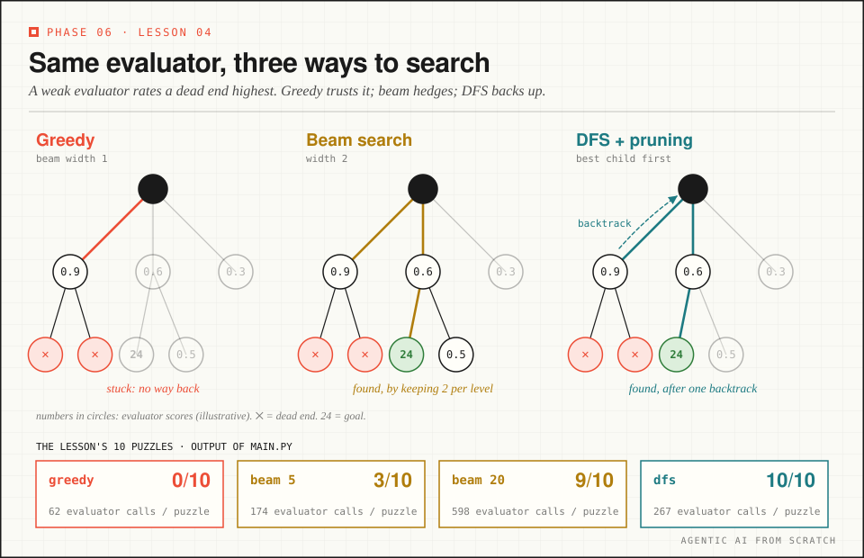

# Tree of Thoughts Search

> Don't commit to the first idea. Propose several next steps, score how promising each one is, and search: keep the best few, or go deep and back up when a path dies. Every score you ask for is a model call, so the search strategy is also your budget.

**Type:** Build
**Languages:** Python 3.10+ (stdlib only)
**Prerequisites:** Phase 6 · Lessons 1 and 3
**Time:** ~60 minutes

## Learning Objectives

- Frame a problem as search over "thoughts": states, a proposer of next steps, an evaluator of states, and a goal test.
- Implement greedy search, beam search and depth-first search with pruning and backtracking.
- Count evaluator calls as the cost, and compare success against cost across strategies.
- Explain why a weak evaluator makes greedy search fail and backtracking succeed, and when this kind of search is worth its price.

## The Problem

Some problems can't be solved left to right. In the Game of 24 (combine 4, 9, 10 and 13 with + − × ÷ to make 24), the first step that looks good often leads nowhere, and you only find out two steps later. A model generating an answer token by token is doing greedy search: it commits to each step and can't take it back.

Tree of Thoughts (Yao et al., 2023) makes the search explicit. The model proposes a few candidate steps, the model (or code) rates the states they lead to, and a search algorithm decides what to explore. On the Game of 24, the paper reported GPT-4 going from 4% with chain-of-thought to 74% with ToT. The cost was many more model calls per puzzle.

This lesson builds the search with an exact proposer and a cheap heuristic evaluator, so you can see what the search strategy alone contributes, and what it costs.

## The Concept

### Four pieces

| Piece | Here | In ToT with a model |
|-------|------|---------------------|
| **State** | Numbers left, each with the expression that made it | The partial solution so far |
| **Proposer** | Every legal "combine two numbers" step | The model proposes k next steps |
| **Evaluator** | A heuristic value in [0, 1] | The model rates states "sure / likely / impossible" |
| **Goal test** | One number left, equal to 24 | Same |

### Three strategies

| Strategy | Keeps | Backtracks | Cost |
|----------|-------|------------|------|
| **Greedy** (beam width 1) | The single best state per level | No | Lowest |
| **Beam search** (width b) | The b best states per level | No, but has b chances | Grows with b |
| **DFS** with pruning | One path, best child first | Yes: a dead end returns to the last choice | Depends on how good the evaluator's ranking is |

### The evaluator decides everything

Each strategy trusts the evaluator differently. Greedy follows it blindly: if the top-rated first step is a dead end, it's over. Beam search hedges with width. DFS uses the evaluator only to *order* the children and to prune hopeless ones, and recovers from bad orderings by backtracking. A weak evaluator hurts greedy most.

## Build It

```bash
cd code
python3 main.py
```

```text
all 10 puzzles are solvable: True

strategy     solved  evaluator calls  calls per puzzle
greedy          0/10              618                62
beam 5          3/10             1737               174
beam 20         9/10             5985               598
dfs            10/10             2667               267

some solutions found by dfs:
  (1, 5, 5, 5) -> 5*(5-(1/5)) = 24
  (3, 3, 8, 8) -> 8/(3-(8/3)) = 24
  (1, 4, 5, 6) -> 6/((5/4)-1) = 24
```



Ten puzzles, all solvable (an exhaustive search checks). The evaluator is deliberately weak at depth 1: it prefers states where two numbers multiply to something near 24, which is often the wrong idea.

- **Greedy: 0/10.** It follows the heuristic's first choice on every puzzle, and the heuristic's first choice is never right here.
- **Beam 5: 3/10; beam 20: 9/10.** Width compensates for a weak evaluator, at a price: beam 20 costs nearly 600 evaluator calls per puzzle.
- **DFS: 10/10 at 267 calls per puzzle.** It uses the same evaluator, but only to decide what to try first and what to prune; when a path dies, it backs up. Less than half of beam 20's cost, and it solved more.
- The three solutions shown are the classic hard ones: they need fractions (`5 × (5 − 1/5)`), which a left-to-right "looks close to 24" approach never reaches.

With a model as evaluator, every one of these calls is a model call. 267 calls per puzzle is affordable for a puzzle benchmark and not for most production requests. That's the real lesson: search is for problems where being right matters more than the cost of many calls, and where a good evaluator exists.

### Step 1: States and `propose()`

A state is a tuple of `(Fraction, expression)`. `propose()` returns every state reachable by combining two numbers, skipping mirrored duplicates like `a+b` / `b+a`. Fractions keep `8/3` exact; with floats, `8 / (3 − 8/3)` comes out as 23.99999999999999.

### Step 2: `heuristic()`

With two numbers left, it looks one step ahead exactly (1.0 if 24 is reachable, else 0.0), like the paper's "sure / impossible". With three or four, it scores how close the best pairwise product gets to 24. That's cheap and often misleading, which is the point.

### Step 3: `beam()` and `dfs()`

`beam()` expands every state in the frontier, scores all children, and keeps the top `width`. `dfs()` scores the children of a state, tries them best-first, skips those under the pruning threshold, and returns the first solution it finds. `Counter` wraps the evaluator and counts calls, which is how the cost column is produced.

### Step 4: A model as the evaluator

```bash
export AGENT_BASE_URL=http://localhost:11434/v1
export AGENT_MODEL=llama3.2
python3 main.py --live
```

`model_value()` asks the model whether three numbers can make 24 and maps "sure / likely / impossible" to 1.0 / 0.5 / 0. (Two-number states still use the exact check.) It's slow: hundreds of calls per strategy. Compare the solved column with the offline heuristic. Is a model a better evaluator than "close to 24"? Does DFS still win if the model rates good states "impossible" and prunes them?

### Run the tests

```bash
python3 -m unittest -v test_main
```

Seven tests: proposals reduce the state by one number, exact fractions and no division by zero, the goal test, the exact two-number evaluation, all puzzles solvable, the scoreboard, and a found solution evaluating to exactly 24.

## Use It

| Tool | Search over reasoning |
|------|-----------------------|
| Tree of Thoughts (Yao et al.) | BFS/beam and DFS over model-proposed, model-evaluated thoughts |
| Graph of Thoughts | Thoughts can merge and be refined, not just branch |
| LATS | Monte Carlo tree search over agent actions, with reflection |
| Reasoning models | Much of this search now happens inside the model's hidden reasoning (Lesson 9) |

## Ship It

`outputs/skill-thought-search.md` is a skill that decides whether a task needs search, then sets it up: state, proposer, evaluator and goal test; strategy choice; a call budget; and a measurement of success against evaluator calls.

## Exercises

1. **Easy.** Change the DFS pruning threshold to 0 and to 0.2. How do solved count and calls change?
2. **Medium.** Make the proposer return only the 4 children with the highest heuristic, like a model proposing a few ideas. Which strategies lose puzzles?
3. **Medium.** Write a better heuristic for three-number states (try: can any pair combine to a number that, with the third, makes 24 in one step?). Re-run all strategies.
4. **Hard.** Implement best-first search with a priority queue over all open states, capped at 100 evaluator calls per puzzle. Compare it with DFS at the same budget.

## Key Terms

| Term | What people say | What it actually means |
|------|-----------------|------------------------|
| Tree of Thoughts | "ToT" | Explicit search over intermediate reasoning steps, with proposal and evaluation |
| Thought | "A step" | One intermediate step that moves from one partial solution to the next |
| Beam search | "Keep the top k" | At each depth, keep only the k best-scoring states |
| Backtracking | "Undo and try another" | Returning to the last choice point when a path fails |
| Evaluator | "Value function" | Whatever scores how promising a state is; its quality decides which strategy works |

## Further Reading

- [Yao et al., Tree of Thoughts: Deliberate Problem Solving with Large Language Models (2023)](https://arxiv.org/abs/2305.10601)
- [Long, Large Language Model Guided Tree-of-Thought (2023)](https://arxiv.org/abs/2305.08291)
- [Besta et al., Graph of Thoughts (2023)](https://arxiv.org/abs/2308.09687)
- [Zhou et al., Language Agent Tree Search (LATS, 2023)](https://arxiv.org/abs/2310.04406)
