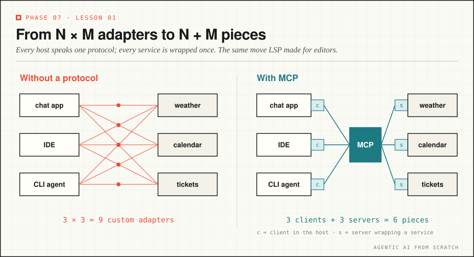

# Why MCP Exists

> Every agent host wants the same tools, and every tool wants to be in every host. Without a shared protocol that is hosts × services pieces of glue. MCP puts one protocol in the middle so it becomes hosts + services.

**Type:** Build
**Languages:** Python 3.10+ (stdlib only)
**Prerequisites:** Phase 2 · Lessons 2, 3 and 10
**Time:** ~35 minutes

## Learning Objectives

- Explain the N × M integration problem and why it grows faster than either side.
- Name MCP's three roles (host, client, server) and its three server primitives (tools, resources, prompts), and who controls each.
- Build an in-process MCP-shaped server and client and connect three hosts with different tool-call formats to the same servers.
- Separate what MCP standardises (discovery, invocation, errors) from what it leaves to the host (the model, the prompt, approval UI).

## The Problem

In Phase 2 you wrote tool schemas and a dispatcher (Phase 2 · Lessons 2 and 3), then saw that each provider wants the schema in its own envelope (Phase 2 · Lesson 10). That was one host and a handful of tools you wrote yourself.

Now scale it. Your company has a chat app, an IDE plugin and a CLI agent. People want each of them to reach the weather service, the calendar and the ticket system. Each service has its own API style: one takes positional arguments and returns a tuple, one takes a request dict and returns a status code, one is keyword-only and raises. Each host has its own tool-call format.

Every pair needs glue: parse this host's tool call, call that service's API, format the result back. Three hosts and three services is nine adapters. Thirty hosts (every editor, every chat product, every agent framework) and four hundred services is twelve thousand, and each one is written by someone who knows one side well and the other side barely. When the ticket system adds a tool, every host's adapter has to change before anyone can use it.

## The Concept



The idea isn't new. The Language Server Protocol did the same for editors and programming languages: before LSP, every editor needed its own plugin for every language. MCP borrows LSP's shape directly, including its wire format, JSON-RPC 2.0.

**Roles.**

| Role | What it is | Example |
|------|-----------|---------|
| Host | The application the user runs; owns the model, the conversation, and the approval UI | A chat app, an IDE, a CLI agent |
| Client | A connector inside the host; one client talks to one server | The host's MCP client code |
| Server | A program that exposes capabilities over MCP | A weather, files or tickets server |

**Server primitives**, and who decides when they're used:

| Primitive | Controlled by | Used for |
|-----------|--------------|----------|
| Tools | The model | Actions and lookups the model chooses to call (`get_forecast`, `close_ticket`) |
| Resources | The application | Data the host attaches as context (a file, a record, a schema) |
| Prompts | The user | Templates the user picks, often as slash commands |

**What MCP standardises:** how a host discovers what a server offers (`tools/list`), how it invokes something (`tools/call`), the shape of results and errors, versioning, and transports. **What it doesn't:** which model the host uses, how tools are presented to it, whether a call needs the user's approval, or what the agent loop looks like. Those stay in the host. MCP is not an agent framework and not a model API.

This course teaches the current revision, **2026-07-28**. It is stateless: there is no connection handshake, and every request carries the protocol version and the client's capabilities in `params._meta`. Older revisions (2025-11-25 and earlier) started each connection with an `initialize` handshake; you'll meet it again in Lesson 5, because clients still need to talk to older servers.

## Build It

```bash
cd code
python3 main.py
```

```text
Integration glue: hosts x services vs hosts + services
 hosts  services  without  with MCP
     3         3        9         6
     3        10       30        13
    10        50      500        60
    30       400    12000       430
```

Everything runs in-process: the servers are plain objects whose `handle` method takes a JSON-RPC message dict and returns one, and each host's "model" is a scripted tool call in that host's format. Lesson 2 puts the same messages on a real wire.

### Step 1: three services, three native APIs

`WeatherAPI.forecast` takes positional arguments and returns a tuple. `CalendarAPI.handle` takes a request dict and returns a status code. `TicketsAPI.search` is keyword-only. Each is a realistic shape you'd find behind a real service. Without a protocol, every host has to learn all three.

### Step 2: wrap each service once as a server

A server exposes tool definitions (name, description, JSON Schema for the input) and handles two methods:

```python
def handle(self, msg):
    method, params = msg["method"], msg.get("params", {})
    if method == "tools/list":
        result = {"resultType": "complete", "tools": [d for d, _ in self.tools.values()],
                  "ttlMs": 300000, "cacheScope": "public"}
    elif method == "tools/call":
        ...
        result = handler(**params.get("arguments", {}))
```

The service-specific code (turning a tuple into text, unwrapping a status code) lives here, written once by the people who know the service. Every result has the same shape: `content` (a list of text or other blocks), `isError`, and `resultType`. `ttlMs` and `cacheScope` tell clients how long they may cache the list.

### Step 3: one client per host

The client asks each server for its tools, remembers which server owns which tool, and routes calls. Every request carries the protocol metadata:

```python
params = {**params, "_meta": {"io.modelcontextprotocol/protocolVersion": PROTOCOL_VERSION,
                              "io.modelcontextprotocol/clientCapabilities": {}}}
```

The only host-specific part is translating an MCP tool definition into the host's model format, and parsing the model's tool call back out. That's a few lines per host, not per service:

```python
def to_openai(tool):
    return {"type": "function", "function": {"name": tool["name"], "description": tool["description"],
                                             "parameters": tool["inputSchema"]}}

def to_anthropic(tool):
    return {"name": tool["name"], "description": tool["description"], "input_schema": tool["inputSchema"]}
```

### Step 4: three hosts, same servers

```text
[chat-app] discovered 4 tools: get_forecast, list_events, search_tickets, close_ticket
  first tool in this host's format: {"type": "function", "function": {"name": "get_forecast", "description": "Today's foreca...
  scripted model asks for get_forecast({"city": "Lisbon"})
  result: Lisbon: 21°C, sunny
  wire: -> weather: tools/call {"name": "get_forecast", "arguments": {"city": "Lisbon"}}

[ide] discovered 4 tools: get_forecast, list_events, search_tickets, close_ticket
  first tool in this host's format: {"name": "get_forecast", "description": "Today's forecast for a city.", "input_schema": ...
  scripted model asks for search_tickets({"text": "vpn"})
  result: T-2: VPN drops
  wire: -> tickets: tools/call {"name": "search_tickets", "arguments": {"text": "vpn"}}
```

The model call arrived in three different shapes, but by the time it hits the wire it's always `tools/call` with `name` and `arguments`.

### Step 5: a service adds a tool

```text
A service adds a tool (tickets gets 'reopen_ticket')
  tools each host sees after re-listing: [5, 5, 5]
  host code edits without a protocol: 3  with MCP: 0
```

The server changed; every host picked up the new tool by listing again. That's the second half of the win: not just less glue, but glue that doesn't need to change when a service grows.

### Step 6: errors in one shape

```text
Errors come back in one shape, whichever host asked
  tool-level failure: ERROR: no open ticket T-9
  protocol error:     Unknown tool: delete_everything
```

MCP separates two kinds of failure. A tool that ran and failed returns a normal result with `isError: true`, and that text goes back to the model as an observation it can react to (Phase 2 · Lesson 5). A request the server couldn't process at all (an unknown tool, an unknown method) is a JSON-RPC error, which the client handles in code. Lesson 3 builds both properly.

### Run the tests

```bash
python3 -m unittest -v
```

## Use It

| Host | MCP support |
|------|------------|
| Claude apps, Claude Code | Connect local (stdio) and remote (HTTP) MCP servers |
| VS Code, Cursor, other IDEs | Agent modes that load MCP servers from a config file |
| OpenAI and Google agent SDKs | MCP server connectors alongside native function tools |
| Official SDKs | TypeScript, Python, and other languages, for writing servers and clients |

The ecosystem moved fast: most "add X to my agent" integrations are now MCP servers, and many SaaS products publish their own. That's why the rest of this phase builds both sides from the wire up, so you know what an SDK is doing when it works and where to look when it doesn't.

## Ship It

`outputs/skill-mcp-integration-audit.md` is a skill that audits an agent product's integrations: counts the bespoke host × service adapters, identifies which should become MCP servers and which hosts need an MCP client, and decides what stays outside MCP (model choice, approval UI, loop design).

## Exercises

1. **Easy.** Add a fourth host format (any provider you know) with a `to_x` function and a scripted call. How many lines did it take? How many would it have taken without the shared servers?
2. **Medium.** Add a `notes` server with two tools. Which code changed: servers, clients, or both?
3. **Medium.** Make two servers expose a tool with the same name (`search`). What does `MiniClient.route` do? Write down two ways a host could handle the collision (Lesson 9 comes back to this).
4. **Hard.** Write the "without a protocol" version for real: one adapter function per (host, service) pair, each parsing the host's call and calling the native API. Compare line counts with the MCP version at 3 × 3 and estimate at 10 × 50.

## Key Terms

| Term | What people say | What it actually means |
|------|-----------------|------------------------|
| MCP | "USB-C for AI tools" | An open protocol, JSON-RPC 2.0 based, for hosts to discover and use tools, resources and prompts from servers |
| Host | "The app" | The user-facing application that owns the model, conversation and approval UI |
| Client | "Connector" | Code inside the host that talks to one MCP server |
| Server | "An MCP" | A program exposing tools, resources and/or prompts over MCP |
| N × M problem | "Integration hell" | Each host needs bespoke glue for each service; a shared protocol makes it N + M |
| Primitive | "MCP feature" | One of tools (model-controlled), resources (application-controlled), prompts (user-controlled) |

## Further Reading

- [Model Context Protocol specification, 2026-07-28](https://modelcontextprotocol.io/specification/2026-07-28)
- [MCP architecture overview](https://modelcontextprotocol.io/docs/learn/architecture)
- [Anthropic, Introducing the Model Context Protocol (2024)](https://www.anthropic.com/news/model-context-protocol)
- [Language Server Protocol](https://microsoft.github.io/language-server-protocol/)
- [JSON-RPC 2.0 specification](https://www.jsonrpc.org/specification)
