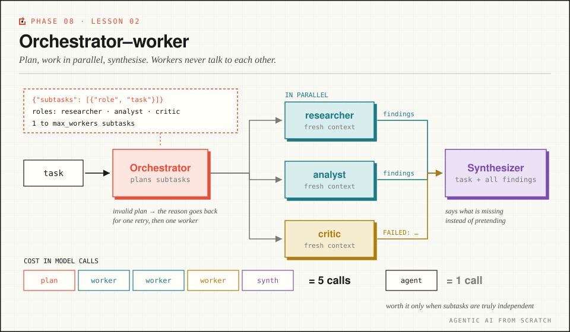

# Orchestrator–Worker

> One agent plans, several agents work in parallel, one agent writes the answer. It's the most useful multi-agent pattern, and the easiest to overuse.

**Type:** Build
**Languages:** Python 3.10+ (stdlib only)
**Prerequisites:** Phase 3 · The Agent Loop, Phase 8 · Lesson 1 (When one agent is not enough)
**Time:** ~55 minutes

## Learning Objectives

- Implement the orchestrator–worker pattern in three phases: plan (fan-out), parallel work, and synthesis (fan-in).
- Make the orchestrator's plan machine-checkable: JSON, validated, with one repair attempt and a safe fallback.
- Isolate worker failures so one crash or timeout degrades the answer instead of killing the run.
- Measure the cost of coordination in model calls and tokens, and decide when it's worth paying.

## The Problem

A single agent with a long task does everything in sequence, in one ever-growing context window. Ask it to research two frameworks, compare them, and list the risks, and you get three jobs in one transcript. The early research crowds out room for the analysis, and nothing runs in parallel.

The obvious fix is several agents. But "several agents" without structure becomes a group chat: agents talk past each other, repeat work, and burn tokens. You need a shape. The most reliable one is a **manager who plans and delegates, specialists who work independently, and an editor who merges the results.**

## The Concept



### Three phases

| Phase | Who | Input | Output |
|-------|-----|-------|--------|
| **Plan** | Orchestrator | The user's task | A JSON list of independent subtasks, each with a role |
| **Work** | Workers, in parallel | One subtask each, in a fresh context | Findings |
| **Synthesize** | Synthesizer | Task + every worker's findings (and failures) | The final answer |

Workers don't talk to each other. That's the point: each gets a small, focused context, and they can run at the same time.

### The plan is a contract

The orchestrator's output is parsed by code, so it must be structured and **validated**:

- JSON only, with `{"subtasks": [{"role": ..., "task": ...}]}`
- every role comes from a fixed list (`researcher`, `analyst`, `critic`)
- between 1 and `max_workers` subtasks

When validation fails, the *reason* goes back to the orchestrator as feedback for one retry ("unknown role 'poet'"). If that fails too, degrade gracefully to a single worker. A bad plan should never crash the run.

### Failures are findings

A worker can crash, time out, or return garbage. The orchestrator records the error and passes it to the synthesizer as `FAILED: …`. A good synthesizer then says what's missing instead of quietly pretending the analysis happened.

### Coordination has a price

A single call costs 1 model call. Orchestrator–worker with 3 workers costs **5**: plan + 3 workers + synthesis. Each worker also re-reads instructions, and the synthesizer re-reads everything. Use the pattern when subtasks are genuinely independent and parallel speed or focused context pays for the overhead. Otherwise, one good agent wins.

## Build It

```bash
cd code
python3 main.py
```

### Step 1: Parse and validate the plan

`parse_plan` finds the JSON object even when the model wraps it in prose ("Here is the plan: {…}"), checks every role and task, and raises `PlanError` with a reason precise enough to send back to the model.

### Step 2: Orchestrate

`orchestrate(task, llm)` runs the three phases:

```python
plan = parse_plan(call(planner, prompt), max_workers)       # 1. plan (+1 repair, then fallback)

with ThreadPoolExecutor(max_workers=max_workers) as pool:   # 2. fan out
    futures = [pool.submit(work, s) for s in plan]
    results = [fut.result(timeout=worker_timeout) ...]      #    plan order is preserved

answer = call(SYNTHESIZER, f"Task: {task}\n\nFindings:\n{findings}")   # 3. fan in
```

`work()` wraps each worker in `try/except` and returns a `WorkerResult` with either `output` or `error`. Results stay in plan order so the synthesizer reads them in the sequence the orchestrator intended.

### Step 3: Count the cost

Every model call goes through one `call()` wrapper that counts calls and characters. Characters ÷ 4 is a rough token estimate, good enough to compare patterns. The demo prints:

```text
cost: 5 model calls, ~598 tokens (1 plan + 3 workers + 1 synthesis)
```

### Step 4: Run it on a real model

```bash
AGENT_BASE_URL=http://localhost:11434/v1 AGENT_MODEL=llama3.2 python3 main.py
```

Here's an actual run from building this lesson, on a laptop with Ollama:

```text
workers:
  [analyst   ] FAILED (timed out after 60.0s)
  [researcher] ok in 19.85s
  [critic    ] ok in 33.22s

cost: 5 model calls, ~4151 tokens (1 plan + 3 workers + 1 synthesis)
```

Three lessons are in that output:

1. **"Parallel" depended on the server.** Ollama processed the three workers one at a time on this machine, so the queued analyst blew through its timeout. Parallelism is a property of your inference backend, not your thread pool.
2. **Isolation worked.** The run still finished, and the synthesizer's answer said the analyst had timed out and that more research was needed. That's honest degradation.
3. **The cost was real.** About 4,150 tokens, against a few hundred for one direct question. The small model's answer was also vaguer than the scripted one. More agents did not mean a better answer.

### Run the tests

```bash
python3 -m unittest -v test_main
```

Seven tests cover JSON-in-prose, every plan rejection reason, the plan size limit, the full run, an isolated worker failure (and that the synthesizer is told), repair-then-fallback, and real parallelism with order preserved.

## Use It

| Framework | Orchestrator–worker looks like |
|-----------|--------------------------------|
| LangGraph | The `Send` API fans out to worker nodes, and a reducer collects results |
| OpenAI Agents SDK | A manager agent calls worker agents as tools (`agent.as_tool()`) |
| Claude Agent SDK | A lead agent delegates to subagents, each with its own context window |
| CrewAI | `Process.hierarchical` with a manager LLM assigning tasks to the crew |

Anthropic's multi-agent research system uses this shape. Their write-up reports large gains on broad research questions and much higher token use than single-agent chat. That's the same trade-off you just measured.

## Ship It

`outputs/skill-orchestrator-worker.md` is a skill that helps your coding agent decide *whether* a task needs orchestrator–worker, then scaffold it with a validated plan, isolated workers, and cost accounting.

## Exercises

1. **Easy.** Add a fourth role, `coder`, and a demo task that uses it. What changes in the planner prompt?
2. **Medium.** Start each worker's timeout when it actually *starts* running, not when the orchestrator begins waiting. (Hint: record a start time inside `work()`.) Re-run against Ollama and compare.
3. **Medium.** Give each worker the agent loop from Phase 3 · Lesson 1 and a `lookup` tool, so workers can act, not just think.
4. **Hard.** Add a budget: stop launching workers and go straight to synthesis once the estimated tokens pass a limit. How does the synthesizer explain the missing work?

## Key Terms

| Term | What people say | What it actually means |
|------|-----------------|------------------------|
| Orchestrator | "Manager agent" | Plans and delegates; its output is a machine-checked plan |
| Worker | "Sub-agent" | Runs one subtask in its own fresh context, independent of other workers |
| Fan-out / fan-in | "Parallelize" | Split into independent subtasks, then merge the results |
| Synthesizer | "Writer" | The final call that sees every result and failure and writes the answer |
| Coordination cost | "Overhead" | The extra calls and tokens spent planning and merging instead of working |

## Further Reading

- [Anthropic, *How we built our multi-agent research system*](https://www.anthropic.com/engineering/multi-agent-research-system)
- [Anthropic, *Building Effective Agents*: orchestrator-workers workflow](https://www.anthropic.com/research/building-effective-agents)
- [LangGraph, Map-reduce with the Send API](https://langchain-ai.github.io/langgraph/how-tos/map-reduce/)
- [OpenAI Agents SDK, Agents as tools](https://openai.github.io/openai-agents-python/tools/#agents-as-tools)
