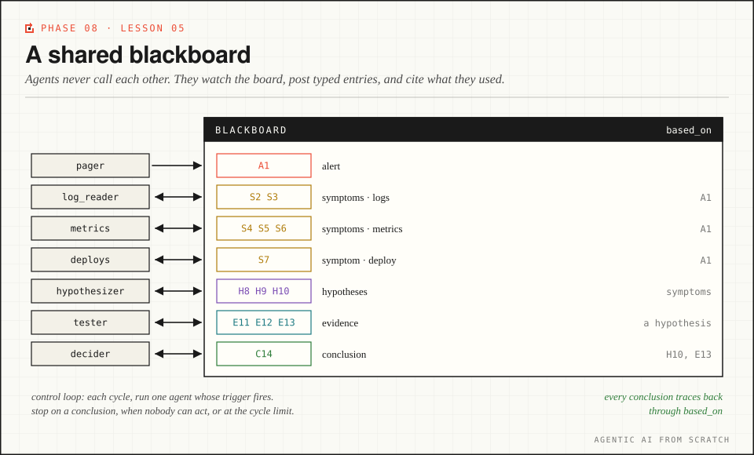

# Shared Blackboards

> Instead of a manager telling agents what to do, every agent watches a shared board and acts when it sees something it can use. The order of work emerges from the data. That makes it easy to add a new specialist and harder to predict what will happen, so the board needs structure, provenance and a control loop.

**Type:** Build
**Languages:** Python 3.10+ (stdlib only)
**Prerequisites:** Phase 8 · Lesson 2; Phase 4 · Lesson 6
**Time:** ~45 minutes

## Learning Objectives

- Build a blackboard with typed entries, authors and provenance links (`based_on`).
- Write agents as trigger + action pairs, and a control loop that picks which agent acts each cycle and stops cleanly.
- Add a new agent without changing the others and see the conclusion improve.
- Prevent lost updates when two agents edit the same entry, using versioned (optimistic) writes.

## The Problem

An orchestrator (Lesson 2) has to know the plan up front: who does what, in which order. That's fine for "research these three vendors". It's awkward for an investigation, where nobody knows in advance what will turn up. Logs show pool exhaustion, which suggests a hypothesis, which needs a test, whose result might call for a deploy check that wasn't on anyone's plan.

You could write that as a growing chain of handoffs, or a supervisor that re-plans after every result. Or you could do what incident rooms do: put everything on one shared board, and let each specialist step in when they see something in their area. The last option is a pattern from 1970s AI research (the Hearsay-II speech system), and it fits agents surprisingly well.

## The Concept



| Piece | What it is |
|-------|-----------|
| Entry | A typed record: `kind`, `content`, `author`, `based_on` (provenance), `version` |
| Knowledge source | An agent with a **trigger** (can I act on the board as it is?) and an **action** (post or update entries) |
| Control loop | Picks which triggered agent runs next (here: a fixed priority order), and decides when to stop |
| Provenance | Every entry lists the entries it was derived from, so any conclusion can be traced back |

**Compared with an orchestrator:** no one holds the plan, agents don't call each other, and a new agent plugs in by watching the board. The costs: you have to design entry types carefully (they're the interface between agents), the order of work is harder to predict, and termination isn't automatic. A loop with no stop condition will happily keep posting.

**Concurrent writes.** If two agents read an entry, both change it, and both write it back, the second write silently erases the first: a lost update. Versioned writes fix it: each write states the version it read, and fails if the entry has moved on. The loser re-reads and retries.

## Build It

```bash
cd code
python3 main.py
```

The agents are scripted functions so the run is deterministic. In a real system each would be a model call or a tool-using agent. The board, triggers, loop, provenance and versioning work the same either way.

### Step 1: the board

```python
def post(self, kind, content, author, based_on=None):
    ...
def update(self, entry_id, content, expected_version):
    with self.lock:
        e = self.entries[entry_id]
        if e.version != expected_version:
            raise Conflict(f"{entry_id} is at v{e.version}, you read v{expected_version}")
        e.content, e.version = dict(content), e.version + 1
```

### Step 2: agents as trigger + action

```python
def tester(bb):
    untested = [h for h in bb.all("hypothesis") if h.content["status"] == "untested"]
    if untested:
        h = untested[0]
        def act():
            verdict, why = CHECKS[h.content["claim"]]
            ev = bb.post("evidence", {"verdict": verdict, "detail": why}, "tester", [h.id])
            ...
        return act
```

Returning `None` means "nothing for me here". The decider only fires when every hypothesis has been tested, and picks the supported hypothesis that no other supported hypothesis explains: the cause behind the cause.

### Step 3: run the loop

```text
Incident: checkout is slow. Sources: log_reader, metrics_agent, hypothesizer, tester, decider
  cycle  1: log_reader      posted S2, S3
  cycle  2: metrics_agent   posted S4, S5, S6
  cycle  3: hypothesizer    posted H7, H8
  cycle  4: tester          posted E9
  cycle  5: tester          posted E10
  cycle  6: decider         posted C11
  conclusion: database connection pool exhausted
```

Nobody wrote "read logs, then metrics, then hypothesise". The hypothesizer ran when there were symptoms; the tester ran while there were untested hypotheses.

### Step 4: add a specialist

```text
Add one source (deploy_watcher). Nothing else changes.
  cycle  1: log_reader      posted S2, S3
  cycle  2: metrics_agent   posted S4, S5, S6
  cycle  3: deploy_watcher  posted S7
  cycle  4: hypothesizer    posted H8, H9, H10
  cycle  5: tester          posted E11
  cycle  6: tester          posted E12
  cycle  7: tester          posted E13
  cycle  8: decider         posted C14
  conclusion: bad deploy v3.18 leaks connections
```

The first run's answer, "pool exhausted", was true but shallow: it's a symptom. With a deploy on the board, the hypothesizer could propose a deeper cause, the tester confirmed it, and the decider chose it because it explains the pool exhaustion. No other agent's code changed. That's the blackboard's main selling point.

### Step 5: why do we believe it?

```text
  why (provenance):
    C14 conclusion by decider: root_cause=bad deploy v3.18 leaks connections
      H10 hypothesis by hypothesizer: claim=bad deploy v3.18 leaks connections [supported]
        S2 symptom by log_reader: source=logs, fact=ERROR pool exhausted (50/50 connections)
          A1 alert by pager: service=checkout-api, fact=p99 latency > 3s
        S7 symptom by deploy_watcher: source=deploys, fact=10:02 checkout-api v3.18 deployed
          A1 (above)
      E13 evidence by tester: verdict=supports, detail=connections never released in v3.18 code path
        H10 (above)
```

With many agents writing to one place, "where did this come from?" is the most important question you can answer. A conclusion without a chain back to observed facts is a hallucination with extra steps (Lesson 11).

### Step 6: lost updates

```text
Two testers add a note to the same hypothesis at the same time
  blind writes    : notes kept ['b'], conflicts retried: 0
  versioned writes: notes kept ['a', 'b'], conflicts retried: 1
```

Both testers read version 1. With blind writes, tester b's write replaced tester a's note. With versioned writes, b's write failed with a conflict, b re-read version 2 and added its note to it.

### Run the tests

```bash
python3 -m unittest -v
```

## Use It

| Where you'll see it | Form |
|---------------------|------|
| Agent frameworks' shared state | A state object every node reads and updates (LangGraph state, with reducers deciding how concurrent updates merge) |
| Shared scratchpads / memory files | Agents reading and appending to one document or store (Phase 4) |
| Incident tooling | A timeline that responders and bots post to |
| Databases | Optimistic concurrency with version columns or ETags (`If-Match`) |

## Ship It

`outputs/skill-blackboard-design.md` is a skill for building a blackboard system: entry types as the contract between agents, provenance on every entry, triggers that can't fire forever, a control loop with stop conditions, versioned writes, and a review of who can write what.

## Exercises

1. **Easy.** Reorder the sources so the tester comes before the hypothesizer. Does the result change? Why or why not?
2. **Medium.** Make the control loop choose by priority score instead of list order: a source's score is how many new entries it could react to. Show a case where this changes the order of work.
3. **Medium.** Add a `skeptic` source that posts a `challenge` entry against any conclusion whose evidence comes from only one source, and make the decider wait for challenges to be answered.
4. **Hard.** Run the sources concurrently (threads), each looping on its trigger. What breaks without versioned writes? Where do you need idempotency so two testers don't test the same hypothesis twice?

## Key Terms

| Term | What people say | What it actually means |
|------|-----------------|------------------------|
| Blackboard | "Shared workspace" | A store of typed entries that all agents read and write; the only channel between them |
| Knowledge source | "Specialist agent" | An agent defined by a trigger (when it can contribute) and an action |
| Control loop | "Scheduler" | Chooses which triggered agent runs next and when to stop |
| Provenance | "Lineage" | Links from each entry to the entries it was derived from |
| Optimistic concurrency | "Versioned writes" | Writes that fail if the entry changed since it was read; the writer re-reads and retries |
| Lost update | "Clobbered write" | One concurrent write silently overwriting another |

## Further Reading

- [Erman et al., The Hearsay-II Speech-Understanding System (1980)](https://dl.acm.org/doi/10.1145/356810.356816)
- [Blackboard system (overview)](https://en.wikipedia.org/wiki/Blackboard_system)
- [LangGraph, State and reducers](https://langchain-ai.github.io/langgraph/concepts/low_level/#reducers)
- [Martin Kleppmann, Designing Data-Intensive Applications: lost updates](https://dataintensive.net/)
