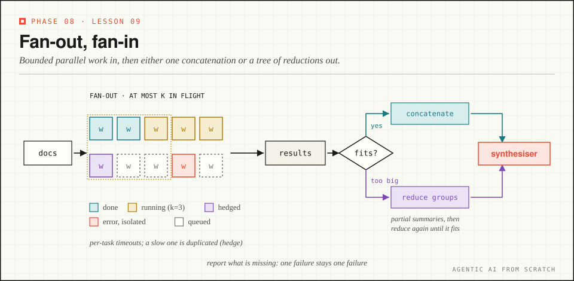

# Parallel Fan-Out, Fan-In

> Sending 24 independent subtasks to workers at once should take as long as the slowest one, not the sum. In practice the slowest one is very slow, the provider caps how many requests you can have in flight, and the results don't fit in one context. Fan-out needs limits and a plan for the tail; fan-in needs a plan for size.

**Type:** Build
**Languages:** Python 3.10+ (stdlib only)
**Prerequisites:** Phase 8 · Lesson 2; Phase 2 · Lesson 4; Phase 3 · Lesson 6
**Time:** ~45 minutes

## Learning Objectives

- Bound concurrency to the provider's limit, and show why going over it wastes calls without saving time.
- Handle tail latency with per-task timeouts, hedged requests and quorums, and state what each trades away.
- Isolate failures and timeouts per subtask so one bad item doesn't sink the batch.
- Reduce many results into one answer with a tree when they don't fit the synthesiser's window.

## The Problem

Lesson 2's orchestrator fanned out to three workers. Real batches are bigger: summarise 24 documents, check 50 suppliers, review 200 pull requests. The obvious code (start everything, wait for everything) breaks in four ways:

- **Rate limits.** Your API key allows a fixed number of concurrent requests. Starting 24 at once turns most of them into `429 Too Many Requests`, and naive retries hammer the API further.
- **Tail latency.** Most model calls take a few seconds; some take thirty. Waiting for all of them means waiting for the worst one, every time.
- **Partial failure.** One document is corrupt, or one call times out. "Wait for all" turns that into a failed batch.
- **Fan-in overflow.** 24 summaries of 600 tokens is 14,400 tokens, more than the synthesiser's window here.

## The Concept



| Technique | Buys | Costs |
|-----------|------|-------|
| Bounded concurrency (k = provider limit) | No 429 storms; predictable load | Nothing you'd get from going higher |
| Per-task timeout | A deadline for the whole batch | Missing results for slow items |
| Hedged request (duplicate after p-th percentile) | Most of the tail removed, all results kept | A few extra calls |
| Quorum (stop at X% done) | Fastest answer | The last items are never used |
| Per-item error isolation | One failure stays one failure | You must report what's missing |
| Tree reduce | Any number of results fits the window | Extra calls and another level of summarising |

A **hedged request** comes from large-scale web systems (Dean and Barroso, "The Tail at Scale"): if a request hasn't returned by the time most requests have, send the same request again and take whichever answer comes first. Because slowness is usually about the moment (a busy server, a long queue) rather than the request, the duplicate usually returns quickly.

## Build It

```bash
cd code
python3 main.py
```

Worker latencies are simulated (seeded, with a heavy tail like real model APIs) and scheduled with a small discrete-event simulation, so the timings are exact and reproducible. `fan_out()` is the real threaded implementation; the tests run it with short sleeps.

### Step 1: the workload

```text
24 documents; worker latency 3-6 s typically, slowest three: [32.5, 26.4, 22.6] s (simulated)
```

### Step 2: schedule it six ways

```python
def schedule(lat, slots, timeout=None, hedge_after=None, backoff_429=2.0, limit=RATE_LIMIT):
    ...
        in_flight = [e for e in in_flight if e > t]
        calls += 1
        if len(in_flight) >= limit:        # provider says 429
            errors += 1
            pending[w] = task
            heapq.heappush(events, (t + backoff_429, w))
            continue
```

```text
  strategy                                      done    time  calls  429s
  sequential (1 worker)                         24/24  175.9s     24     0
  all at once (24 workers, provider limit 8)    24/24   46.5s     98    74
  bounded: 8 workers                            24/24   44.4s     24     0
  bounded + 12 s timeout per task               21/24   23.9s     24     0
  bounded + hedge after 8 s                     24/24   24.4s     27     0
  bounded: stop at a quorum of 80%              20/24   16.7s    24*     0
  * the quorum run started all 24 calls; the last ones are cancelled or ignored
```

What to take from it:

- **Going over the limit bought nothing.** 24 workers finished slightly later than 8, and made 98 calls instead of 24, because 74 of them were rejected with 429. Match concurrency to the limit.
- **The tail dominates.** With 8 workers the batch took 44 seconds, though most documents take under 6. Three slow calls set the finish time.
- **Three ways to cut the tail.** A 12-second timeout finished in 24 seconds but lost 3 documents. Hedging finished in about the same time with all 24 documents, for 3 extra calls. A quorum answered in 17 seconds using 20 of 24.

Which is right depends on the task: missing 3 of 24 search results is fine, missing 3 of 24 contract clauses isn't.

### Step 3: the real fan-out

```python
def fan_out(fn, items, max_workers, timeout=None):
    pool = cf.ThreadPoolExecutor(max_workers=max_workers)
    futures = {pool.submit(fn, item): i for i, item in enumerate(items)}
    try:
        for fut in cf.as_completed(futures, timeout=timeout):
            ...
            except Exception as e:  # one failure doesn't sink the batch
                errors[i] = f"{type(e).__name__}: {e}"
    except cf.TimeoutError:
        ... errors[i] = "timed out"
```

The pool size is the concurrency bound. Results and errors come back keyed by item, so the synthesiser can be told exactly what's missing (Lesson 2's "failures are findings").

### Step 4: fan-in that fits

```python
def reduce_plan(n_results, per_result=SUMMARY_TOKENS, window=WINDOW, group_tokens=500):
    if n_results * per_result <= window:
        return {"levels": 1, "calls": 1, "final_input": n_results * per_result}
    while items * per > window:
        group = max(2, window // per)
        items, per = -(-items // group), group_tokens
```

```text
Fan-in: 24 summaries x 600 tokens into an 8000-token synthesiser
    8 results: concatenate        1 reduce call(s), final input  4800 tokens
   13 results: concatenate        1 reduce call(s), final input  7800 tokens
   24 results: tree, 2 levels     3 reduce call(s), final input  1000 tokens
  100 results: tree, 2 levels     9 reduce call(s), final input  4000 tokens
```

Up to 13 summaries fit and are concatenated. Beyond that, groups of 13 are summarised first, then the group summaries are combined. Each level is another chance to drop a detail, so keep the number of levels low and tell intermediate reducers what the final answer needs.

### Run the tests

```bash
python3 -m unittest -v
```

## Use It

| Tool | Fan-out / fan-in support |
|------|-------------------------|
| `asyncio.Semaphore`, `ThreadPoolExecutor(max_workers)` | Bounded concurrency in plain Python |
| LangGraph `Send` | Dynamic fan-out to a node per item, with a reducer merging results into state |
| Provider batch APIs | Very large, latency-tolerant batches at lower cost, results within hours |
| Map-reduce chains | Tree reduction of many documents into one summary |

## Ship It

`outputs/skill-fan-out-fan-in.md` is a skill for designing a parallel agent batch: concurrency from the rate limit, a tail policy (timeout, hedge or quorum) chosen by how much a missing item costs, per-item error reporting, retry with backoff for 429s, and a fan-in plan that fits the window.

## Exercises

1. **Easy.** Hedge after 5 seconds instead of 8. How many extra calls, and how much faster? Where's the knee?
2. **Medium.** Sort the queue so the documents most likely to be slow (say, the longest ones) start first. What happens to the bounded run's finish time?
3. **Medium.** Make the 429 backoff exponential with jitter (1, 2, 4 s, plus or minus 20%). Re-run "all at once". Does it ever beat bounded?
4. **Hard.** Implement `fan_out` with `asyncio` and an `asyncio.Semaphore`, including hedging: start a duplicate after a delay and cancel the loser.

## Key Terms

| Term | What people say | What it actually means |
|------|-----------------|------------------------|
| Fan-out / fan-in | "Scatter / gather", "map / reduce" | Splitting work into parallel subtasks, then merging their results |
| Bounded concurrency | "Max workers" | A cap on requests in flight, matched to the provider's limit |
| Tail latency | "p99" | The slow end of the latency distribution, which sets a batch's finish time |
| Hedged request | "Backup request" | Re-sending a slow request and taking the first answer |
| Quorum | "Good enough" | Finishing when a set fraction of results is in |
| Tree reduce | "Hierarchical summarisation" | Merging results in groups, level by level, so each step fits the window |

## Further Reading

- [Dean and Barroso, The Tail at Scale (2013)](https://research.google/pubs/the-tail-at-scale/)
- [Python docs, concurrent.futures](https://docs.python.org/3/library/concurrent.futures.html)
- [LangGraph, Map-reduce with Send](https://langchain-ai.github.io/langgraph/how-tos/map-reduce/)
- [Anthropic, Message Batches API](https://docs.claude.com/en/docs/build-with-claude/batch-processing)
- [AWS Architecture Blog, Exponential Backoff and Jitter](https://aws.amazon.com/blogs/architecture/exponential-backoff-and-jitter/)
