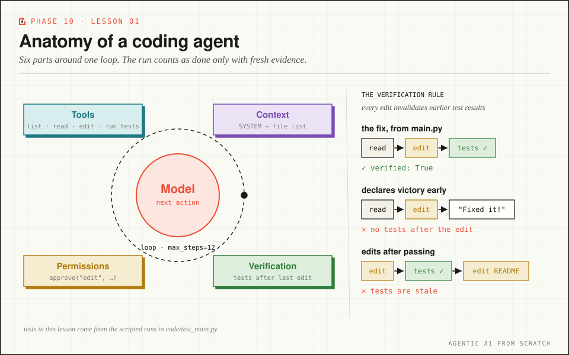

# Anatomy of a Coding Agent

> A coding agent is the Phase 3 loop with a particular toolbox: look around, read, edit, run. What makes it trustworthy is the last part. "Done" means a test run passed after the last edit, checked by your code, not claimed by the model. Every coding agent you'll meet, from Claude Code to SWE-agent, has these six parts.

**Type:** Build
**Languages:** Python 3.10+ (stdlib only)
**Prerequisites:** Phase 3 · The agent loop in 120 lines; Phase 2 · Human approval gates; Phase 9 · Claude Agent SDK
**Time:** ~45 minutes

## Learning Objectives

- Name the six parts of a coding agent and point to each in about 150 lines of code.
- Build a minimal agent that reproduces a failing test, reads code, edits it with approval, and re-runs the tests.
- Verify completion in code: a passing test run *after* the last edit, not the model saying "done".
- Map each part to how real coding agents implement it.

## The Problem

You ask an agent to fix a failing test. It reads the file, makes an edit, and says "Fixed! All tests should pass now." You merge it. They don't pass. The agent never ran them, or it ran them before its final edit.

"Should pass" is the most expensive phrase in coding agents. Models are fluent at describing success. The only thing that separates a coding agent from a code-flavoured chatbot is that it **checks**, and that the harness, not the model, decides whether the check counts.

## The Concept



| # | Part | Job | In `main.py` | Later lesson |
|---|------|-----|--------------|--------------|
| 1 | Model | Decide the next action | `llm(messages, SCHEMAS)` | — |
| 2 | Tools | Explore, read, edit, run | `list_files`, `read_file`, `edit_file`, `run_tests` | 2, 3, 9 |
| 3 | Loop | Act, observe, repeat, with a step budget | `run(..., max_steps=12)` | 4, 10 |
| 4 | Context | What the model knows about the repo and the rules | `SYSTEM` with the file list | 5, 6 |
| 5 | Permissions | Which actions need a human | `approve("edit", ...)` | 3, 9 |
| 6 | Verification | Evidence the task is done | last test run after last edit passed | 4 |

**The verification rule:** every edit invalidates earlier test results. The run is verified only if the most recent `run_tests` came *after* the most recent successful edit and reported PASSED.

## Build It

```bash
cd code
python3 main.py
```

`make_repo()` writes a three-file repo to a temp directory. `stats.py` has a bug: `mean()` divides by `len(xs) - 1`.

### Step 1: tools with a jail

```python
def _path(self, rel):
    p = (self.root / rel).resolve()
    if self.root.resolve() not in (p, *p.parents):
        raise PermissionError(f"{rel} is outside the repo")
    return p
```

`read_file` adds line numbers, so the model can talk about line 3. `edit_file` replaces exactly one occurrence of `old` and refuses otherwise (Lesson 2 explains why). `run_tests` returns PASSED or FAILED plus the last lines of output.

### Step 2: permissions in the tool, not the prompt

```python
if not self.approve("edit", f"{path}: {old!r} -> {new!r}"):
    return "error: the user declined this edit"
```

The prompt asks the model to behave. The approval check *makes* it behave. A declined edit becomes an observation, so the model can try something else or explain.

### Step 3: the loop tracks verification

```python
if name == "edit_file" and out.startswith("edited"):
    last_tests = ""                              # an edit invalidates earlier test results
if name == "run_tests":
    last_tests = out
...
verified = last_tests.startswith("PASSED")
```

### Step 4: run it

```text
  [approve edit] stats.py: '(len(xs) - 1)' -> 'len(xs)' -> yes

  6 verification               run_tests()
                               -> FAILED
  2 tools/read                 read_file(path='stats.py')
                               ->   1| def mean(xs):
  5 permission + 2 tools/edit  edit_file(path='stats.py', old='(len(xs) - 1)', new='len(xs)')
                               -> edited stats.py
  6 verification               run_tests()
                               -> PASSED

answer: Fixed mean(): it divided by len(xs) - 1. Tests pass.
verified by a passing test run after the last edit: True · steps: 5
```

The scripted model starts by running the tests, which reproduces the bug before touching code. Good human engineers work the same way.

### Run the tests

```bash
python3 -m unittest -v
```

One test has the model edit and then declare victory without running tests. The answer says "Fixed it!" and `verified` is `False`. Another edits the README after the tests passed, which also makes `verified` `False`.

## Use It

| Part | Claude Code / Agent SDK | Aider | SWE-agent / OpenHands |
|------|-------------------------|-------|-----------------------|
| Tools | Read, Edit, Write, Glob, Grep, Bash | edit formats applied to files | a custom agent-computer interface: viewer, search, edit commands |
| Context | CLAUDE.md, file reads on demand, compaction | a repository map of key symbols | file viewer windows, search results |
| Permissions | permission modes, allow rules, hooks | asks before applying or running | runs inside a sandbox |
| Verification | runs tests via Bash when told to; hooks can enforce it | optional lint/test after edits | task-specific test runs |

The six parts are always there. What differs is how much of each the tool builds in, and how much it leaves to your prompt.

## Ship It

`outputs/skill-coding-agent-anatomy.md` is a skill for reviewing a coding agent setup: find each of the six parts, check that verification is enforced in code, and list gaps such as no path jail, no step budget, or edits without approval.

## Exercises

1. **Easy.** Add a `grep` tool and change the script to find `mean` before reading the file.
2. **Medium.** Make `run()` refuse to finish (return an observation "Run the tests first") when the model answers without verification, up to two times.
3. **Medium.** Point `main.py` at a local coding model. How often does it run the tests before editing? After editing?
4. **Hard.** Add a second bug in another file. Measure steps, tokens and verification across 10 runs with a real model.

## Key Terms

| Term | What people say | What it actually means |
|------|-----------------|------------------------|
| Coding agent | "AI that writes code" | A tool loop over explore/read/edit/run tools in a repository |
| Verification | "Tests pass" | Evidence checked by the harness that the change works, collected after the last edit |
| Path jail | "Sandboxed file access" | Refusing any path that resolves outside the repository root |
| Reproduce first | "Run the failing test" | Confirming the bug before changing code, so the fix can be confirmed too |
| Agent-computer interface | "Tools for the agent" | The commands and output formats designed for a model to operate a computer |

## Further Reading

- [Yang et al., SWE-agent: Agent-computer interfaces enable automated software engineering (2024)](https://arxiv.org/abs/2405.15793)
- [Anthropic, Claude Code best practices for agentic coding (2025)](https://www.anthropic.com/engineering/claude-code-best-practices)
- [Aider documentation](https://aider.chat/docs/)
- [OpenHands](https://github.com/All-Hands-AI/OpenHands)
- [Jimenez et al., SWE-bench (2023)](https://arxiv.org/abs/2310.06770)
