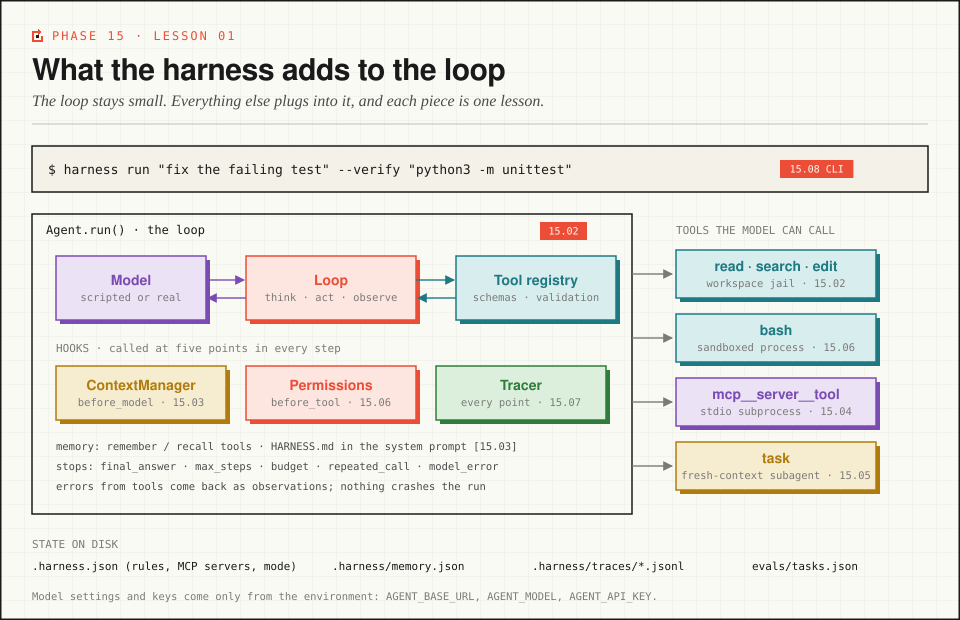

# Why Build a Harness

> The model decides what to do. The harness decides what's allowed to happen, what the model gets to see, and whether "done" is true.

**Type:** Learn
**Languages:** Python 3.10+ (stdlib only)
**Prerequisites:** Phases 02–12; Phase 10 · Build a mini coding agent
**Time:** ~35 minutes

## Learning Objectives

- Explain what an agent harness is, and how it differs from the agent loop and from the model.
- Run a bare agent loop against seven ordinary situations and name the failure in each.
- Map each failure to the harness part that handles it: registry, context manager, MCP client, subagents, permissions, evals, verification.
- Describe the plan for this phase: one harness, built lesson by lesson, shipped as a CLI.

## The Problem

By now you've written an agent loop many times. It's twenty lines: call the model, run the tools it asks for, append the results, repeat. It works in a demo.

Then you point it at a real repository. The model sends arguments with a missing brace, and the run dies with a traceback. It reads a log file and the context window overflows. It calls `list_files` fifty times in a row. It runs `rm -rf` because you gave it a shell. And it ends with "Fixed, all tests pass", having edited nothing.

None of these are model bugs you can prompt away. Better models make them rarer, not impossible, and you can't ship on "rarer" when the tool is a shell. What handles them is the code *around* the model: the **harness**. Claude Code, Codex CLI, Cursor's agent and the OpenAI and Claude Agent SDKs are all harnesses. In this phase you build one.

## The Concept



### Model, loop, harness

| | What it is | Who writes it |
|-|------------|---------------|
| Model | Text in, text or tool calls out | The provider |
| Loop | Call model → run tools → repeat | You, in Phase 3, in 20 lines |
| Harness | Everything that makes the loop safe and useful on real work: tools, context, permissions, limits, records, checks, an interface | You, in this phase |

### Seven situations, seven parts

`code/main.py` runs a bare loop against seven scripted situations. Each one is something real models do. Each row below names the harness part that deals with it, and the lesson where you build that part:

| Situation | Bare loop | Harness part | Lesson |
|-----------|-----------|--------------|--------|
| Broken JSON arguments | Crashes | Registry validates; errors become observations | 15.02 |
| A tool the loop doesn't have | Crashes | Registry + MCP: tools from outside, unknown = error | 15.04 |
| The same call over and over | Runs until something external stops it | Stop conditions: steps, budget, repeated calls | 15.02 |
| A huge tool result | Context overflows | Output clipping, context manager | 15.03 |
| A question that needs 30 files | Every file stays in context | Subagents with fresh context | 15.05 |
| A destructive command | Runs it | Permissions (allow/ask/deny), sandboxed shell | 15.06 |
| "Tests pass" with no test run | Reports success | Evals, traces, a verify step | 15.07, 15.08 |

### Design rules for this phase

1. **The loop is written once.** After 15.02, `loop.py` never changes. Everything else plugs in through **hooks** (called at five points in each step) or **tools** (added to the registry). If a feature needs the loop rewritten, the design is wrong.
2. **Errors are observations.** No tool failure, bad argument or blocked call crashes the run. The model sees what went wrong and can recover.
3. **Deny by default where it matters.** Read-only tools run freely. Anything with side effects is asked about, unless a rule says otherwise.
4. **Records you can trust.** Every run leaves a trace. Evals check what the agent *did*, not what it said.
5. **Standard library only.** About 2,000 lines you can read in an afternoon.

### How the code is laid out

Each lesson's `code/harness/` folder is a snapshot of the package after that lesson. 15.02 starts with six modules, and each later lesson adds modules without editing the earlier ones. To see exactly what a lesson added, diff two snapshots:

```bash
diff -r 05-subagents-delegation/code/harness 06-permissions-sandbox/code/harness
```

## Build It

This lesson's code is the bare loop and the seven situations, with no harness at all:

```bash
cd code
python3 main.py
```

### Step 1: the bare loop

```python
def bare_loop(task, llm, tools, max_calls=50):
    messages = [{"role": "user", "content": task}]
    for _ in range(max_calls):
        reply = llm(messages)
        messages.append(reply)
        if not reply.get("tool_calls"):
            return {"answer": reply["content"], ...}
        for c in reply["tool_calls"]:
            args = json.loads(c["arguments"])                       # trusts the model's JSON
            result = tools[c["name"]](**args)                       # trusts the name and the arguments
            messages.append({"role": "tool", "content": str(result)})   # keeps everything, forever
```

`max_calls` is there only so the demo terminates. Most first loops don't have it.

### Step 2: the situations

Each scenario gives the loop a scripted model that does one realistic thing, and reports what happened. The `bash` tool is a fake that records the command instead of running it.

### Output

```text
1. Model sends broken JSON arguments
   bare loop: crashed: JSONDecodeError (Expecting ',' delimiter); the run and its progress are lost
   harness:   tool registry: validate, errors become observations  [15.02]

2. Model calls a tool the loop doesn't have
   bare loop: crashed: KeyError 'get_ticket'; there's no way to add tools from outside the code
   harness:   registry + MCP client: tools from outside, unknown = error  [15.04]

3. Model repeats the same call
   bare loop: called list_files 50 times in a row and never answered; nothing noticed
   harness:   stop conditions: steps, budget, repeated calls  [15.02]

4. A tool returns a huge result
   bare loop: one log read put ~90,057 tokens in context (281% of a 32k window)
   harness:   output clipping + context manager  [15.03]

5. A question needs 30 files read
   bare loop: 30 file reads stay in the main context: ~23,625 tokens re-sent on every later call, for a one-line answer
   harness:   subagents: read in a fresh context, return a summary  [15.05]

6. Model runs a destructive command
   bare loop: ran 'rm -rf ~/ && git push --force' without asking anyone (here it's pretend; in a real shell it isn't)
   harness:   permissions (allow/ask/deny) + sandboxed shell  [15.06]

7. Model says 'tests pass' without running them
   bare loop: returned 'Fixed restock(); all tests pass.' after 1 call(s): no edit, no test run, reported as success
   harness:   evals + traces, and a verify step  [15.07, 15.08]
```

Situation 7 isn't hypothetical. In 15.08, llama3.2 does exactly this on the demo project: it invents a bug, edits nothing, and says the tests pass.

### Run the tests

```bash
python3 -m unittest -v
```

## Use It

How production harnesses cover the same seven parts:

| Part | Claude Code | OpenAI Agents SDK | Your harness (end of phase) |
|------|-------------|-------------------|-----------------------------|
| Tools and validation | Built-in tools, JSON Schema | `@function_tool` | `ToolRegistry` |
| Context | Auto-compaction, `CLAUDE.md` | Sessions | `ContextManager`, `HARNESS.md` |
| External tools | MCP servers | MCP servers | `mcp.py` stdio client |
| Delegation | Subagents (Task tool) | Handoffs, agents as tools | `task` tool, profiles |
| Safety | Permission rules and modes, hooks | Guardrails | `Permissions`, `Sandbox` |
| Records | Transcripts, hooks | Tracing | `Tracer`, JSONL |
| Checking | Hooks running tests | Output guardrails | `--verify`, `harness eval` |

Product features change quickly, so check each one's current docs before relying on a row. The point isn't to copy any of them. Every harness needs answers to the same seven questions, and after this phase you'll have written your own answers.

## Ship It

`outputs/prompt-harness-audit.md` is a prompt for auditing any agent setup (yours, a framework's, a vendor's) against the seven parts: what it does in each situation, and what's missing.

## Exercises

1. **Easy.** Add an eighth situation: the model replies with an empty message (no content, no tool calls). What does the bare loop return? What should a harness do?
2. **Medium.** Add a situation where a tool hangs forever (`time.sleep(3600)`). The bare loop has no answer to this. Which harness part handles it, and where does the timeout belong: the loop, the registry, or the tool?
3. **Medium.** Pick an agent framework you've used. For each of the seven situations, find in its docs what it does. Where you can't find an answer, write down what you'd expect it to do.
4. **Hard.** Situation 5 is about context, but delegation also costs tokens. Estimate the total tokens for the 30-file question with and without a subagent, assuming the parent re-sends its whole context on every call. When does delegating save tokens overall, and when does it only keep the parent clean? (15.05 measures it.)

## Key Terms

| Term | What people say | What it actually means |
|------|-----------------|------------------------|
| Harness | "The agent" | The code around the model loop: tools, context, permissions, limits, records, checks, interface |
| Agent loop | "ReAct loop" | Call the model, run requested tools, append results, repeat until it answers |
| Hook | "Middleware" | A function the loop calls at a fixed point in each step, which can rewrite, block or record |
| Observation | "Tool output" | What goes back to the model after a call, including errors and denials |
| Verification | "Checking it worked" | A check the harness runs itself, such as the test suite, instead of trusting the model's claim |

## Further Reading

- [Anthropic, Building effective agents](https://www.anthropic.com/engineering/building-effective-agents)
- [Claude Code documentation](https://docs.anthropic.com/en/docs/claude-code/overview)
- [OpenAI Agents SDK documentation](https://openai.github.io/openai-agents-python/)
- [Model Context Protocol specification](https://modelcontextprotocol.io/specification)
