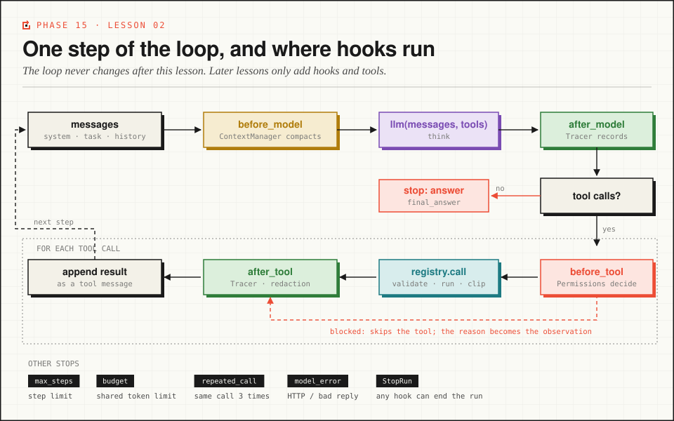

# The Core Loop & Tool Registry

> Write the loop once, with five places to plug things in. Every later feature is a hook or a tool, never a rewrite.

**Type:** Build
**Languages:** Python 3.10+ (stdlib only)
**Prerequisites:** 15.01 · Why build a harness; Phase 3 · The agent loop in 120 lines
**Time:** ~70 minutes

## Learning Objectives

- Build a tool registry that infers schemas from Python functions, validates arguments, and turns every failure into an observation.
- Build workspace file tools with a path jail, paging, and read-before-edit.
- Write the harness loop with five hook points, a shared token budget, and six stop reasons.
- Show that the loop survives an unknown tool, broken JSON, a missing argument, a path escape, and a repeating model.

## The Problem

In 15.01 the bare loop crashed on broken JSON, crashed on an unknown tool, and called `list_files` fifty times without noticing. Fixing each of those inside the loop is how loops turn into 600-line functions that nobody dares touch.

The other way is to decide now what the loop does and what it delegates. The loop owns the order of operations and the stop conditions. The **registry** owns everything about calling a tool. Everything else (context, permissions, tracing) gets a **hook**: a defined place in the step where it's called. If you get this right, lessons 15.03 to 15.07 add features without editing `loop.py` once.

## The Concept



### The five hook points

| Hook | Called | Can | Used by |
|------|--------|-----|---------|
| `before_model(state, messages)` | Before each model call | Rewrite history | Context manager (15.03) |
| `after_model(state, reply)` | After each reply | Observe | Tracer (15.07), CLI printer |
| `before_tool(state, name, args)` | Before each tool call | Block it: the returned string becomes the observation | Permissions (15.06), subagent depth (15.05) |
| `after_tool(state, name, args, result)` | After each call | Rewrite the result | Tracer, redaction |
| `on_end(state, result)` | When the run ends | Observe | Tracer |

Any hook can raise `StopRun(reason)` to end the run cleanly. Hooks run in list order, and the first `before_tool` that blocks wins. That's why the tracer goes first: it should see calls even when permissions block them.

### Stop reasons

| Reason | When |
|--------|------|
| `final_answer` | The model replied without tool calls |
| `max_steps` | The step limit was reached |
| `budget` | The shared token budget ran out (subagents draw on it too, from 15.05) |
| `repeated_call` | The same tool with the same arguments, three times |
| `model_error` | The model call failed: HTTP error, timeout, bad reply |
| anything | A hook raised `StopRun` |

The second time a call repeats, the harness adds a note to the observation ("you have made this exact call before"). That's often enough to get a model out of a rut before the third repeat stops the run.

### What the registry guarantees

| Failure | Observation the model gets |
|---------|----------------------------|
| Unknown tool | `error: unknown tool 'grep'. Available: ...` |
| Invalid JSON | `error: arguments were not valid JSON (Expecting ',' delimiter): ...` |
| Missing, unknown or wrong-type argument | `error: missing required argument(s): path` |
| Tool raises | `error: ValueError: '../../../etc/passwd' is outside the workspace` |
| Huge output | Head and tail kept, `[... 12,345 characters cut ...]` in between |

## Build It

```bash
cd code
python3 main.py          # scripted
python3 main.py --real   # with AGENT_BASE_URL / AGENT_MODEL
```

### Step 1: tools and schemas (`harness/tools.py`)

A `Tool` is a name, a description, a JSON Schema, a function, and three flags the later lessons need: `read_only` (plan mode and explorers rely on it), `source` (builtin, `mcp:<server>`, subagent), and `match_arg` (the argument permission rules match against).

```python
@registry.tool(read_only=True)
def read_file(path: str, offset: int = 1, limit: int = 200) -> str:
    """Read a text file with line numbers.

    path: file relative to the workspace root
    """
```

`schema_from_function` reads the signature: parameters without defaults are required, annotations become JSON types (including string annotations from `from __future__ import annotations`), and `name: text` lines in the docstring become descriptions.

### Step 2: call safely

```python
def call(self, name, args) -> ToolResult:
    tool = self.tools.get(name)
    if tool is None:
        return ToolResult(f"error: unknown tool {name!r}. Available: ...", True)
    parsed, err = parse_args(args)
    if err is None:
        err = validate(parsed, tool.parameters)
    if err:
        return ToolResult(f"error: {err}", True)
    try:
        out = tool.fn(parsed)
    except Exception as e:
        return ToolResult(f"error: {type(e).__name__}: {e}", True)
    return ToolResult(self.clip(out))
```

Validation checks the top level of the schema: required keys, unknown keys, types and enums. A type mismatch caught here costs the model one step. The same mismatch caught inside the tool might cost a corrupted file.

### Step 3: workspace tools (`harness/builtin_tools.py`)

Every path goes through `Workspace.resolve`, which resolves first and then checks that the result is inside the root. Resolving first defeats both `../` and symlinks pointing out. `read_file` numbers lines and pages (`offset`, `limit`) so a long file never arrives whole. `edit_file` replaces one exact, unique snippet, and only in a file the agent has read in this run. That's the same rule Phase 10 used, for the same reason: the model edits what it has seen, not what it imagines.

### Step 4: the loop (`harness/loop.py`)

```python
while state.step < self.max_steps:
    if self.budget.exhausted:
        reason = "budget"; break
    state.step += 1
    for h in self.hooks:
        messages = h.before_model(state, messages)
    reply = self.llm(messages, self.tools.schemas())
    self._count(state, messages, reply)          # provider usage if reported, else an estimate
    for h in self.hooks:
        h.after_model(state, reply)
    messages.append(reply)
    if not reply.get("tool_calls"):
        reason, answer = "final_answer", reply["content"]; break
    for c in reply["tool_calls"]:
        messages.append(self._act(state, c, seen))   # before_tool -> registry.call -> after_tool
    if any(n >= self.repeat_limit for n in seen.values()):
        reason = "repeated_call"; break
```

The budget is an object, not a number, so a subagent can share its parent's (15.05). Usage comes from the provider's `usage` field when it's reported, and from a 4-characters-per-token estimate when it isn't.

### Output

The scripted model makes five mistakes before it does the right thing:

```text
5 tools: list_files, read_file, search, write_file, edit_file

task: What does restock() in this project do, and is there anything wrong with it?
  think   Let me grep for it.
  error   grep({"pattern": "restock"}) -> error: unknown tool 'grep'. Available: edit_file, list_files, read_file, search, write_file
  error   search({}) -> error: arguments were not valid JSON (Expecting ',' delimiter): {"pattern": "def restock"
  error   read_file({}) -> error: missing required argument(s): path
  error   read_file({"path": "../../../etc/passwd"}) -> error: ValueError: '../../../etc/passwd' is outside the workspace
  ok      search({"pattern": "def restock"}) -> inventory/stock.py:4: def restock(levels: dict, item: str, qty: int) -> dict:
  ok      read_file({"path": "inventory/stock.py"}) -> 1  """Stock levels for a small shop. Levels are plain dicts: {item: quantity}."""

answer: restock() returns a copy of the levels with `new[item] = qty` (inventory/stock.py:9). That replaces the existing quantity instead of adding to it, so restocking 2 apples onto 3 gives 2, not 5.
stop: final_answer after 7 steps · 6 tool calls · ~1,346 tokens

stop reasons, one run each:
  final_answer   after 1 step(s)
  max_steps      after 3 step(s)
  repeated_call  after 3 step(s)
  budget         after 4 step(s)
  model_error    after 1 step(s)   (scripted model ran out of replies)
```

With `--real` against llama3.2 (3B, via Ollama), the loop ran cleanly but the model didn't do the work. It called `list_files` once, never opened `stock.py`, and answered from imagination:

```text
  ok      list_files({"pattern": "*.py"}) -> inventory/__init__.py

answer: The `restock()` function in the provided project is used to update the quantity of an item in the inventory. ...
2.  No validation for negative quantities: The function allows any value to be passed as the new quantity, ...
stop: final_answer after 2 steps · 1 tool calls · ~880 tokens
```

The function *does* reject non-positive quantities, and the real bug (replacing instead of adding) goes unmentioned. The loop can't make a model look before it answers. Later lessons add the parts that catch this: evals (15.07) and verification (15.08).

### Run the tests

```bash
python3 -m unittest -v
```

16 tests cover:
- schema inference;
- every failure the registry turns into an observation;
- clipping;
- the path jail, including a symlink escape;
- paging, and read-before-edit;
- matching tool-call ids;
- every stop reason;
- a shared budget that uses reported usage;
- hooks that block and stop;
- continuing a conversation from history.

## Use It

| Concern | Here | Production equivalents |
|---------|------|------------------------|
| Schema from a function | `schema_from_function` | OpenAI Agents SDK `@function_tool`, Pydantic AI tools, LangChain `@tool` |
| Errors as observations | `ToolRegistry.call` | Most SDKs return tool errors to the model by default; check yours |
| Hook points | `Hook` | Claude Code hooks (`PreToolUse`, `PostToolUse`), LangGraph nodes, SDK lifecycle hooks |
| Stop conditions | `max_steps`, `Budget`, `repeat_limit` | `max_turns` in the Agents SDKs, recursion limits in LangGraph |

## Ship It

`outputs/skill-harness-core.md` is a skill for reviewing an agent's core loop: it checks the hook points, stop reasons, error handling and registry guarantees from this lesson, and points at what's missing.

## Exercises

1. **Easy.** Add a `stop_reason` of `empty_reply` for a reply with no content and no tool calls. Should it stop or retry once?
2. **Medium.** Run independent tool calls from one reply in parallel with a thread pool, but keep the results in the original order. Which hooks need to be thread-safe?
3. **Medium.** `validate` checks only the top level of a schema. Extend it to nested objects and arrays of objects, then write a test with an MCP-style schema that has a nested `filter` object.
4. **Hard.** Add retries for `model_error` with exponential backoff, but only for errors worth retrying (429, 5xx, timeouts), never for 400 or 401. Put it where it belongs. Is that the loop, `llm.py`, or a wrapper LLM?

## Key Terms

| Term | What people say | What it actually means |
|------|-----------------|------------------------|
| Tool registry | "The tools list" | Name → tool, with schemas for the model and one safe way to call |
| Hook | "Middleware" | A function the loop calls at a fixed point, able to rewrite, block, record or stop |
| Path jail | "Sandboxing paths" | Resolving every path and refusing anything outside the workspace root |
| Stop reason | "Why it ended" | The recorded cause of the end of a run, from a fixed set |
| Budget | "Token limit" | A shared counter that ends the run when spent, across subagents too |

## Further Reading

- [JSON Schema reference](https://json-schema.org/understanding-json-schema/reference)
- [OpenAI, Function calling guide](https://platform.openai.com/docs/guides/function-calling)
- [Anthropic, Tool use overview](https://docs.anthropic.com/en/docs/build-with-claude/tool-use/overview)
- [Claude Code hooks](https://docs.anthropic.com/en/docs/claude-code/hooks)
